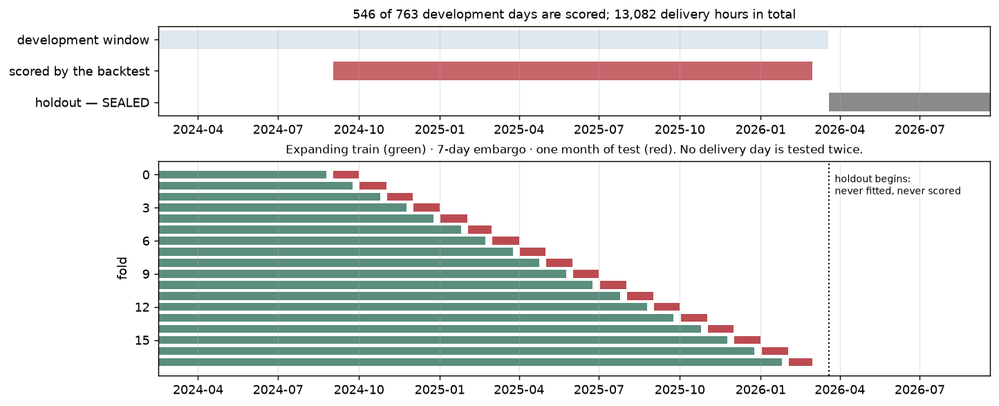
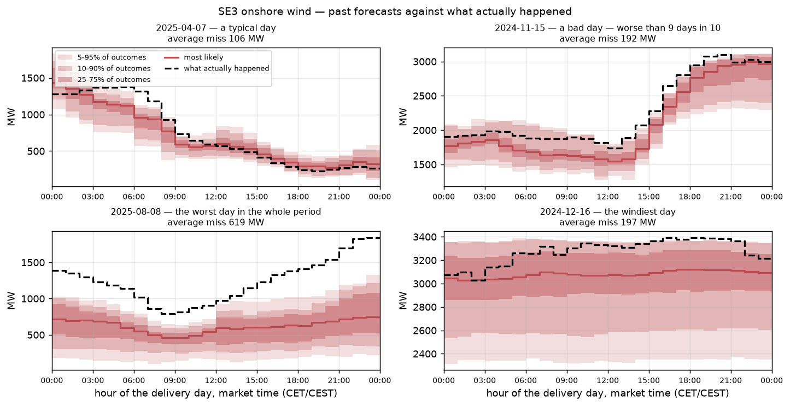

# What the metrics measure, and over which rows

Archived hourly evaluation context. Use [current metrics](../metrics.md) for quarter-hour and forward comparisons. Statements about a sealed holdout below describe the original study, not its current status.


This documents the archived hourly boards. The corrected quarter-hour wind and solar
populations and their added ramp metrics are in `reports/products_15min.md` and the
2026-10-15 protocol amendment. The old hourly results predate the forward-weather
information-age correction and must not be quoted as current-code accuracy.

Every number on the leaderboard is a mean over the **same fixed population of delivery
hours**. This document states exactly which hours those are, what each metric does to
them, and what the numbers mean in megawatts.

Regenerate the figures and the counts below with
`PYTHONPATH=research/src uv run python -m renewable_forecast.reporting.figures`.

---

## 1. Which rows



| | days | delivery hours | dates |
|---|---|---|---|
| Design matrix | 947 | 22,703 | 2024-02-16 → 2026-09-19 |
| Development window | 763 | — | 2024-02-16 → 2026-03-19 |
| **Scored by every metric** | **546** | **13,082** | **2024-09-02 → 2026-03-01** |
| Holdout — SEALED | 184 | — | 2026-03-20 → 2026-09-19 |

**The development window is not the scored window.** 217 development days never appear
in any test fold, for two structural reasons:

- **199 days at the start** (2024-02-16 → 2024-09-01) are train-only. The first fold
  cannot test until it has 180 training days behind it.
- **18 days at the end** (2026-03-02 → 2026-03-19) fall after the last monthly origin.

Every scored day belongs to exactly **one** test fold — no day is counted twice.

### How a fold is built

Expanding train window → 7-day embargo → one calendar month of test. 18 folds, monthly
origins. The embargo exists because adjacent days are strongly autocorrelated: without
it the last training day and the first test day are nearly the same observation.

```
fold 0   train 2024-02-16 … 2024-08-25  │ embargo │ test 2024-09-02 … 2024-10-01
fold 17  train 2024-02-16 … 2026-01-25  │ embargo │ test 2026-02-02 … 2026-03-01
```

Training grows from 192 to 710 days across the folds, so early folds are scored by a
model that has seen less history. That is deliberate — it is what a model deployed in
September 2024 would actually have known — and it means the pooled number is slightly
pessimistic relative to today's model.

### The four days that are not 24 hours long

| day | hours | why |
|---|---|---|
| 2024-10-27, 2025-10-26 | 25 | CET autumn transition — the local day has 25 hours |
| 2025-03-30 | 23 | CEST spring transition |
| 2025-12-01 | **1** | SE zones switched to 15-minute ISP; every partial hour is flagged and dropped, leaving one |

Metrics are pooled **over hours, not averaged per day**, so a 25-hour day carries
25/24 the weight of a normal one. With 546 days the effect is far below the noise floor,
but it is why the counts are quoted in hours.

### What a forecast being scored actually looks like



Each panel is one of the 546 scored days: 24 delivery hours, each with 19 quantiles, and
the outturn in black. Every metric in section 2 is a different way of collapsing the gap
between the fan and the dashed line, summed over all 13,082 such hours.

---

## 2. What each metric does

All model output is a **capacity factor**: `cf = mw / capacity_mw` for that hour, where
`capacity_mw` is the Vindbrukskollen installed capacity on that date. Normalising by
installed capacity rather than mean generation keeps numbers comparable across years as
the fleet grows — a fixed physical error would otherwise appear to shrink simply because
the denominator grew.

Every forecast is **19 quantiles**, levels 0.05 to 0.95 in steps of 0.05. There is no
separate point model: **the point forecast is the median, q0.50.**

| metric | definition | what it tells you |
|---|---|---|
| `nmae` | `mean(abs(cf − q0.50))` | typical error size, in fractions of installed capacity |
| `nrmse` | `sqrt(mean((cf − q0.50)²))` | same, but large errors dominate; the gap to nMAE measures how heavy the error tail is |
| `nbias` | `mean(cf − q0.50)` | **positive = the forecast runs low**, negative = it over-predicts |
| `pinball` | per level `L`: `mean(max(L·d, (L−1)·d))`, `d = cf − q_L` | how good each individual quantile is. At `L = 0.5` it is exactly half the MAE |
| `crps` | `scoringrules.crps_quantile` over all 19 levels, then averaged | **the headline.** Scores the whole distribution at once: a forecast is rewarded for being both accurate and appropriately confident. For a point forecast it degenerates to MAE |
| `coverage_80` | `mean(q0.10 ≤ cf ≤ q0.90)` | should be 0.80. Below means the intervals are too narrow |
| `coverage_90` | `mean(q0.05 ≤ cf ≤ q0.95)` | should be 0.90 |
| `sharpness_80` | `mean(q0.90 − q0.10)` | interval width. **Meaningless alone** — a forecast can be arbitrarily sharp by being overconfident, so it is only readable next to coverage |
| PIT | the predictive CDF evaluated at the observation, interpolated between levels | should be uniform. U-shaped = too narrow, humped = too wide. This is the calibration diagnostic the coverage numbers summarise |

**`CRPSS vs clim.`** on the leaderboard is a skill score: `1 − CRPS_model /
CRPS_climatology`. 0 means no better than climatology; 1 would be perfect; negative is
worse than climatology. Climatology is the denominator because it is the cheapest
forecast that is not trivially bad.

**`significant`** is a day-block bootstrap on the CRPS *difference* against climatology:
resample the 546 delivery days with replacement, 2000 draws, recompute the difference,
check whether the interval excludes zero. Whole days are resampled, never hours —
hours within a day correlate at about 0.95, so resampling hours would inflate the
effective sample size roughly 24-fold and make every interval a fiction.

---

## 3. What the numbers mean in megawatts

Capacity-factor units are convenient and unintuitive. At SE3's current **4,656 MW** of
installed onshore wind:

| leaderboard number | in CF | in MW today |
|---|---|---|
| `lightgbm_quantile` nMAE | 0.0307 | **≈ 143 MW** average absolute error |
| `physical_power_curve` nMAE | 0.0357 | ≈ 166 MW |
| climatology nMAE | 0.1632 | ≈ 760 MW |
| `lightgbm_quantile` sharpness@80 | 0.090 | ≈ 419 MW wide, p10 to p90 |
| mean capacity factor over the scored hours | 0.2778 | — |

Mind the denominator when converting. Capacity grew from 4,187 to 4,689 MW across the
scored window, averaging **4,419 MW**, and mean *actual* generation over those hours was
**1,228 MW**. The MW column above restates each CF figure at today's 4,656 MW, which is
the right basis for "what would this error be now"; using the window average instead
shifts every figure down by about 5%.

So the headline model is wrong by roughly 143 MW in a typical hour against a mean output
near 1,228 MW. Expressed the way the industry usually quotes it — error as a fraction of
*mean generation* rather than of capacity — that is about 11%. Both framings appear in
the literature; this project reports the capacity one everywhere, for the comparability
reason above, and a reader comparing against a published 11%-style number must convert
first.

---

## 4. Breakdowns

`by_lead_hour` and `by_season` are logged as MLflow artifacts per run and computed over
the same 13,082 rows, partitioned. Both carry an `n` column, because a segment with few
rows is a noisy estimate and the pooled number can hide it.

Two breakdowns worth knowing about before reading any pooled number:

- **By lead hour**, error is a step, not a gradient — see `reports/modelling.md`.
  Leads 22-33 average 0.0259 and leads 34-46 average 0.0351, so the pooled 0.0307 is a
  number no individual hour actually experiences.
- **By season**, DJF is worst at 0.0356 with nBIAS −0.0138, meaning the model
  over-predicts in winter.

---

## 5. What is deliberately not measured yet

- **The sealed holdout.** Opened once, when model selection is finished. Nothing in any
  report has touched it.
- **Scenario quality.** `models/scenarios.py` produces temporally coherent draws, but
  marginal CRPS cannot tell a good joint structure from a bad one — that needs variogram
  and energy scores over the whole delivery-day vector.
- **Live skill.** Every number here is a backtest. The Phase 7 dry-run exists to check
  that live nMAE lands within about 1.25× of it; until that runs, these are estimates of
  operational performance, not measurements of it.
