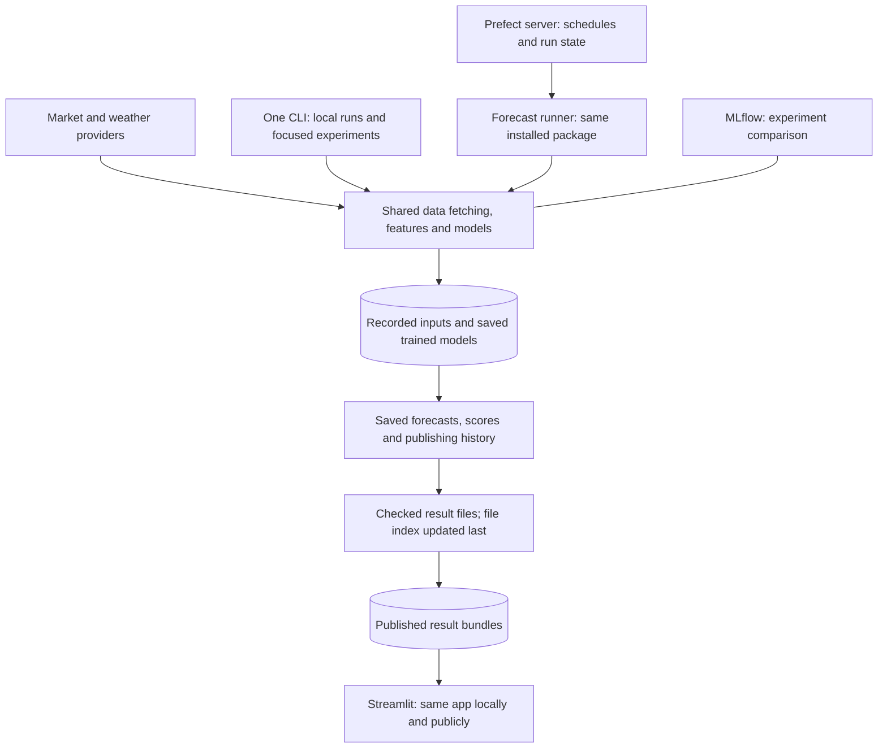

# Project structure and implementation plan

Reviewed 2026-10-26. [ROADMAP.md](../ROADMAP.md) owns the public features and their
order. This document describes how the project should work, which existing parts
are useful and how to replace or remove the rest. **Keep code because it serves
the product, not simply because it already exists.** This review changes
documentation, not application code or running services.

## Goals and recommendation

The agreed portfolio demonstrates **forecasting, ML/deep learning and practical
orchestration/MLOps**. The repository contains the forecast product and directly
related experiments; standalone learning exercises belong elsewhere.

Build **one installable Python product, one CLI and one forecast workflow**.
Use the same functions and commands for local development, experiments, CI and
scheduled deployment. Environments differ in configuration, credentials, data paths
and execution capacity, not in which application implements forecasting.

Keep the evaluated modelling/evaluation core and the Streamlit presentation.
Bring data fetching and forecast publishing into that package. Use Prefect for
forecast orchestration because it serves the explicit MLOps goal. **Retire the
original PostgreSQL market application, its briefing/chat product, obsolete CLI
scaffolds and parallel timer-based forecast scheduler from the target system.**
Extract useful code before removal; do not keep entire services to preserve a
mapping, query or possible future feature.

### How the deployed system should run

This is the planned setup. It has not been implemented yet. Today Prefect runs the
original PostgreSQL data-fetching and briefing jobs; research uses separate module commands and
local systemd timers. The website reads exported research results.

For the first always-on deployment, use one host with a **web service, Prefect
server and forecast runner**, built from versioned releases. Choose Prefect's
static-container `serve` approach: it executes scheduled flows in subprocesses
without requiring the existing work-pool/git-clone deployment pattern. This fits a
fixed host; dynamic infrastructure is not currently needed. See the official
[local-process deployment](https://docs.prefect.io/v3/how-to-guides/deployment_infra/run-flows-in-local-processes)
and [static-container guide](https://docs.prefect.io/v3/how-to-guides/deployment_infra/serve-flows-docker).

Use a persistent SQLite database for the initial single-host Prefect metadata,
separate from forecast data, and verify backup/restart behaviour. Prefect documents
[SQLite as its default server database](https://docs.prefect.io/v3/how-to-guides/self-hosted/server-cli#database-configuration).
This is a starting deployment choice, not a high-availability claim. Reconsider
that backend if measured concurrency or recovery requirements demand it; the
original market PostgreSQL database is not a prerequisite for orchestration.

## What to keep, combine, remove or move

| Existing component | Decision | Reason and destination |
|---|---|---|
| Renewable, price and load models; feature construction; evaluation and leakage tests | **Keep and combine** | They implement the portfolio's core. Move reusable product code into the installed package without changing established model behaviour |
| Model version records, evaluated predictions, reports and useful figures | **Keep as scientific evidence** | Preserve the distinction between development, final and forward results; their value does not require keeping obsolete application code |
| Research data fetching, saved weather forecasts and saved public forecasts | **Use as the main data-fetching code** | They record the data sources and timing needed for honest forecast evaluation. Add observations, zone mappings or transformations from original ingestion only where the product needs them |
| Original PostgreSQL ingestion, schema, queries and region dashboard | **Remove after taking the useful parts** | A second market application and database are not required for the chosen public features. Port useful pure mappings/transformations or required datasets, then remove the old runtime |
| Original briefing and generic chat, agent tools and spend-tracking UI | **Remove from the product** | They solve the earlier market-intelligence goal. A later useful AI feature should be designed and evaluated against the forecast product, not inherit database/tool assumptions |
| Prefect | **Keep the technology; replace the flows** | Orchestration/MLOps is an explicit goal. Replace ingestion/briefing jobs with the forecast lifecycle; do not preserve old flows merely because they are deployed |
| Local forecast systemd installer and shell wrapper | **Remove after switching to Prefect** | Local runs use the same CLI; production has one schedule owner. Preserve existing publication evidence, not a second scheduling system |
| Installed application CLI and research module entrypoints | **Replace with one CLI** | Keep commands for fetching data, training, backtesting, forecasting, scoring, export and UI. Drop obsolete market commands and the research CLI's not-implemented scaffold |
| Streamlit shared explorer, Performance, coverage and methods | **Keep and focus** | They already present forecasts and evidence. Use one navigation model and the same app for local preview and deployment |
| Separate price/load pages and database-dependent supporting-tool navigation | **Merge useful presentation, then remove** | Incorporate relevant scorecards in the shared views; avoid duplicate product pages and a permanent legacy mode |
| Parquet datasets, original provider responses, saved forecasts and job records | **Keep as the product data store** | Suitable for this project's research, batch publication and export workflows; no transactional public API requirement currently justifies a market database |
| Research DuckDB view helper and its stale info CLI | **Remove from required runtime** | Current core pipelines use Parquet directly and the helper's view paths are stale. Add an optional analytical tool later only for a demonstrated query need |
| MLflow | **Keep for experiment tracking** | It directly supports the MLOps story and current research reports. Keep it outside web dependencies; basic forecast and model version records must not import experiment tooling unnecessarily |
| Copernicus discovery notebook and standalone exercises | **Move outside the product repository** | They mainly investigate climate datasets and teach library usage. Carry forward specific useful findings into source documentation; retain only experiments tied to actual forecast questions |
| Old DuckDB migrations, repair scripts and obsolete deployment instructions | **Remove from active tree after checking recovery needs** | Their assumptions conflict with the current application. Git history preserves obsolete code; it should not remain a misleading operational interface |
| Tests, dependency groups and container definitions | **Reshape around retained responsibilities** | Preserve correctness/regression tests for retained behaviour; remove tests and dependencies belonging solely to retired products; add lifecycle integration checks |

Removal is a future migration action, not permission to discard irreplaceable
research or operational data. German research results remain useful case studies;
keeping them does not require continuing German publication jobs. Activate only
products needed by the selected milestone.

## One product across development, experimentation and deployment

### Shared code and commands

Put reusable product code under the existing installable `grid_signals` namespace:
market/product definitions, data fetching, features/models, evaluation, saved models,
publishing/export, scheduling and presentation. The exact internal subdirectories
can follow those responsibilities; do not maintain a second checkout-only package
with competing commands. Move reviewed model code rather than rewrite it.

One CLI calls those shared functions. A forecast flow and a manual forecast command
must not implement separate input selection, fitting, scoring or publication rules.
Retire the ambiguous ingestion-oriented `daily` command and incomplete research CLI
when the replacements are verified. No permanent compatibility layer is required
for this personal project.

Make data/output roots explicit configuration rather than deriving mutable data
locations from the source checkout. Use one market/product registry for provider
codes, target availability, units, temporal conventions and fleet/capacity adapters.
Environment configuration selects local directories or mounted volumes; it does not
select a different pipeline. The website always reads result bundles. The recorded dates
show whether results are historical or current; a separate application mode is unnecessary.

### Focused experimentation

Keep product-related experiment configurations, comparisons and explanatory
notebooks in an experiments area. They import the installed product package and
consume the same datasets/evaluation contracts. Good examples include the SE4
transfer, a deep-learning challenger and a price-input ablation. Generic API
exercises and unrelated climate-catalogue exploration move to a separate learning
workspace. Notebooks do not become production entrypoints or duplicate model logic.

Preserve frozen protocols, source identities and existing results before source
moves. Current model version records contain file checksums, and some publishing code
checks the source paths and checksums against those records. A relocation can therefore break release identity even with unchanged
algorithms. First save copies of the original code and data; do not rewrite old
version records to make new files appear to be the original evaluated release. Register
the consolidated package as a new version and verify it against fixed inputs.

### Forecast workflow and MLOps evidence

Prefect should run data fetching/checks, training/calibration, prediction,
publishing, actuals collection, scoring and export. Flow/task results must expose
failure at those boundaries. A successful process or inserted-row count is not
proof of complete input data or delivery to the public site.

Separate **model preparation** from the deadline-sensitive prediction path. Current
wind, load and price publication functions fit models during publication. That
coupling becomes a resource/deadline problem when expanded across markets. Produce
versioned fitted models on a declared training/calibration schedule, promote a
validated candidate explicitly and record the saved model and training cutoff used
by each forecast. Do not silently substitute a stale or newly trained model.

MLflow compares experiments; small model version records identify approved
saved models, their code/settings, training cutoffs and evaluation results. No
additional model-registry service is required initially. The first SE3 migration
must demonstrate saved models that can be loaded again and equivalent predictions on fixed
inputs before replacing the existing fitting/publication path. Any change to
training availability or policy becomes a new forward model version.

Keep the existing 09:00 UTC information cutoff and 09:30 publication deadline for
the initial product. Save public comparison forecasts before the cutoff; handle
training separately; schedule prediction and later actuals/scoring/export. Preserve
actual creation/publication times, first-eligible issues and late/missing/failed
runs. Retries must not turn retrospective outputs into on-time forecasts. Handle
restarts and overdue runs explicitly, including Prefect schedule behaviour across
runner restarts.

Local development invokes the same operations on fixture or explicitly selected
data. CI verifies them deterministically. Production supplies credentials, schedules,
persistence and measured concurrency/resource limits. Do not maintain local-only
and deployment-only implementations of forecasting.

### Data, serving and recovery

Keep unchanged provider responses, public comparison forecasts and recorded copies of inputs/models
where needed for reproducibility. Keep observations, training files, saved
forecast versions, scorecards and published results as different data products
with clear retention. Reuse a common provider client/cache where appropriate while
preserving the different semantics of actuals, reanalysis and eligible forecasts.

For the first single-host deployment, the runner writes a persistent data volume
and a separate exported-results volume. Mount only exported results read-only in
the web container. Files are named using a checksum of their contents and checked before the
file index is updated; the website displays the data's real dates and freshness.
Bundled historical results support the initial demo and recovery. Daily updates do
not require rebuilding the web image. Off-host delivery/storage can replace this
boundary later if hosting separates.

Back up irrecoverable inputs, model releases, publication evidence, experiment
metadata and the Prefect database, then verify restoration. Retire the market
PostgreSQL backup job with its database. Public metrics come from the forecast
archives/evaluation files, not from Prefect's run database or MLflow alone.

Use dependency profiles for **web**, **forecast runner**, and **experimentation**
around the same package and lockfile. Keep Anthropic, psycopg and generic notebook
clients out of the product unless a retained function actually requires them.
Serve the product through Streamlit initially; a frontend rewrite has no established
benefit for this release.

## Steps toward the new setup

| Stage | Work and exit criterion |
|---|---|
| **Before changing implementation** | Review these target decisions and save copies of the existing code, fixed evaluation datasets/results and publishing history. Identify data that must survive removal; no service is assumed safe to delete because its code is obsolete |
| **1. Historical demo** | Present SE3 wind, German case studies, evidence and methods through the existing app that reads saved results. Expose only the selected product; verify a standalone release. Do not make all backend changes a launch prerequisite. Owner handles deployment later |
| **2a. Bring the code together** | Move reviewed forecasting code into the installed package, provide one CLI/configuration contract, adapt focused experiments and establish fixed-input regression checks. Extract required mappings/data, remove the old market app/agent/runtime dependencies and misleading commands/pages/docs once the replacements work |
| **2b. Operate daily forecasts through Prefect** | Implement the forecast workflow and saved models, versioned runner image, persistent data/results, one schedule owner and tested restart/retry/export semantics. Verify the public scorecard and recovery path, then disable old forecast timers and remove old orchestration/deployment definitions |
| **3. SE4 transfer** | Extend the shared market/product list, data/fleet adapters, paths, scorer and exporter as required. Validate transfer; do not add a second regional pipeline |
| **4. Deep-learning comparison** | Run one bounded experiment through the same data, tracking, saved-model and evaluation rules. Serve it only if it earns promotion |
| **5–8. Regional wind, solar, prices and offshore** | Add one validated zone/target at a time through the same workflow. Audit capacity/target semantics and market-day conventions; UI options alone do not establish coverage |
| **9. Useful AI evaluation** | Identify and evaluate an actual forecast-product task. Design its evidence/tool boundary from the current product; do not restore generic chat because old code exists |

The two parts of milestone 2 are done in order: bring the code together, then run
it reliably. Each stage must leave a usable demo. Remove
retired code and dependencies after its successor is verified, rather than leaving
an indefinite legacy mode. Do not add new modelling tasks while bringing the code together.

### Acceptance and review boundaries

- Historical release: anonymous browsing needs no market database, external keys
  or training; desktop/mobile, missing data, source resolution and DST are checked.
- Shared code: frozen-input predictions, scores and export semantics agree;
  scientific evidence remains reproducible and old version records are not overwritten.
- MLOps: approved saved models can be loaded, per-product failures are visible, revisions do
  not replace scored issues, and restart/retry/partial-actual/export/recovery cases
  work. Assess the existing approximately 30-consecutive-issue reliability gate.
- Focus: one package/CLI, one production scheduler, no required original market
  database, duplicate product navigation, obsolete scaffolds or standalone exercises.
- The original assessment is based on repository code and local saved files. The full test
  suite run before committing returned **394 passed, 1 failed and 2 skipped**.
  The existing failure is in `test_latest_publication_has_actual_status_and_can_return_to_shared_backtest`:
  it expects the newest forecast to be late, which changes when saved results are
  updated. Ruff also reports 21 existing lint issues and 6 files needing formatting.
  These checks record the pre-release state; that review did not fix application
  code, train models, change infrastructure or remove components.

Milestone 1 local release preparation on 2026-10-26 resolves that changing-status
test and the release lint/format checks: **401 passed, 2 skipped**. The website now
leads with SE3 wind, and the standalone image includes only the forecast pages and
current checked result files. Offline image tests and local desktop/mobile review
pass. The owner deployed the test site on 2026-11-01; anonymous HTTPS, desktop/phone
navigation, historical dates and forecast CSV downloads passed public checks. See
the [release review and owner handoff](operations.md#public-hosting). The package/CLI and workflow migration
above remain milestone 2 work.

The observed October 23 SE3 record was 6/8 on-time issues with two timeout failures.
That is useful initial evidence, not a demonstrated reliable service. Existing
[research results](../research/README.md) remain available; live host capacity and
actual deployment state will be established with the owner when deployment is addressed.
