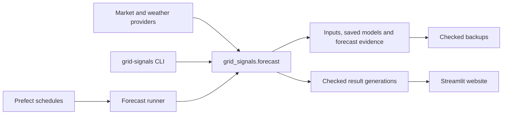

# Architecture and implementation constraints

One installed package and CLI support local work, experiments and scheduled
forecasting. The website reads saved results. [ROADMAP.md](../ROADMAP.md) owns
milestone status and delivery order; [operations](operations.md) owns commands.
The [original assessment and completion record](archive/implementation-history.md)
retains migration decisions and dated validation results.

## How the deployed system should run

[compose.forecast.yaml](../compose.forecast.yaml) defines the single-host setup:

| Service | Responsibility | Persistent state / access |
|---|---|---|
| `prefect` | Schedules and flow/task state | SQLite in `prefect-data`; API internal/host-loopback port 4200 |
| `runner` | Six UTC deployments, one flow slot and a shared data lock | `forecast-data:/data`, `public-results:/results`, `forecast-backups:/backups`; provider key only here |
| `web` | Forecasts, evidence and publication status | Read-only `public-results:/results`; bundled historical fallback; internal port 8501, host-loopback 8503 |

All services run as UID 10001. Default memory caps are 3 GiB for the runner,
1 GiB for Prefect and 768 MiB for the web; the runner has two CPUs. Verify host
headroom before deployment. The standalone historical demo uses
`Dockerfile.demo` and `compose.demo.yaml`, independently of forecast production.

## Shared package and configuration

Reusable code lives in `src/grid_signals/forecast`; `grid-signals` invokes it.
Prefect flows and manual commands use the same functions and eligibility rules.
Product definitions and market metadata are shared with the website.

| Package area | Responsibility |
|---|---|
| `sources/`, `targets/` | Fetch provider data; define observations and capacity |
| `features/`, `models/` | Build eligible inputs and fit/predict |
| `evaluation/`, `pipelines/` | Splits, scores, comparisons and publication |
| `reporting/` | Export portable results and diagnostics |
| `flows.py`, `live.py`, `saved_models.py` | Orchestration, checked delivery and saved-model lifecycle |

The `web`, `runner`, `research` and `dev` dependency groups share `uv.lock`.
Explicit [data/output roots](operations.md#configure-paths-and-dependencies)
select checkout directories or mounted volumes. Configuration must be set before
pipeline imports. Local and deployed environments differ in credentials, paths
and resources; they must not implement different forecast logic.

## Model lifecycle and evidence

SE3 preparation fetches inputs, fits both the model and physical reference,
checks reloaded predictions and explicitly promotes a saved model before the
issue cutoff. Prediction loads that issue's checked model without fitting.
German manual case studies retain fitting during publication and have no new
Prefect schedules.

Each saved model retains training inputs, lag history, cutoff, settings,
code/dependency identities and reload evidence. Reject stale, changed,
incompatible or post-cutoff artifacts. A changed training/refit policy is a new
forward model version. Historical evaluation results do not independently
establish the new daily policy's accuracy.

MLflow supports experiment comparison. Small model version records identify
code/settings and saved models; public forecast archives establish delivery and
performance. Neither Prefect success nor an MLflow run proves public publication.
Exact timing, first-publication identity and scoring eligibility belong to the
[publication contract](integration_contract.md).

## Storage, delivery and recovery

Keep provider responses, required input vintages, observations, fitted models,
publication history, evaluations and exports as distinct file products. Parquet
and small JSON records meet current needs; no market database or public API is
required.

The runner checks a complete immutable result generation before updating its
pointer, then confirms delivery with its actual time. Readers pin a checked
generation and fall back to the previous generation or bundled history with a
warning. Daily updates do not require a web-image rebuild. The website never
trains models or calls provider APIs.

Backups include irrecoverable inputs, model records, publication evidence,
experiment metadata, exported results and a consistent Prefect database copy.
A same-host backup needs an off-host copy and a tested restore. See
[backup and recovery](operations.md#backup-and-recovery).

## Constraints for further changes

- Preserve frozen evaluations, original source paths/checksums and required input
  data. Exact reruns use the [preserved checkout and datasets](archive/operations-record.md#preservation-and-source-consolidation--2026-11-01).
  Moved or changed code gets a separate version record.
- Focused experiments import the product package and use shared data/evaluation
  rules. Standalone learning exercises stay outside this repository.
- Extend the shared registry, source adapters, scorer, exporter and UI for each
  approved zone/target. A registry entry alone does not establish forecast coverage.
- Keep one schedule owner. During the pending cutover, old workstation timers
  use preserved 2a source; the new Prefect schedules default to paused.
- Retired market-database/chat code is preserved in history and recovery copies.
  Its removal does not authorise deleting old running services, volumes or backups.
- Before expanding scope, verify saved-model equivalence, failure visibility,
  restart/retry behaviour and complete public delivery for the current milestone.
