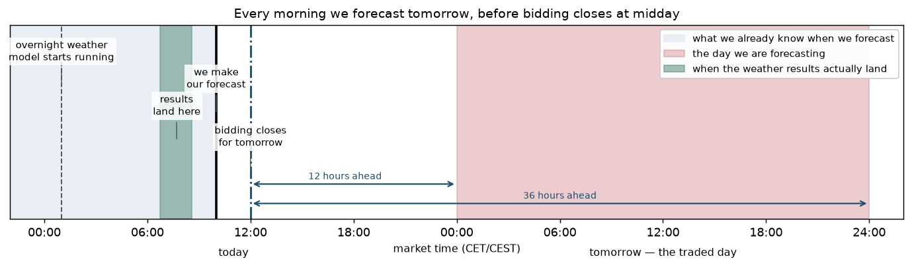
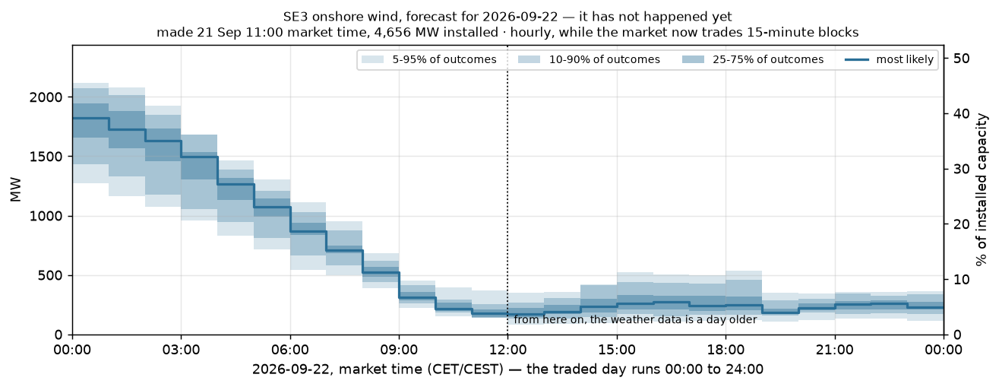
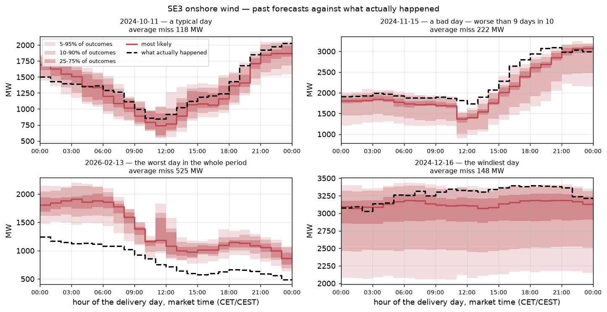
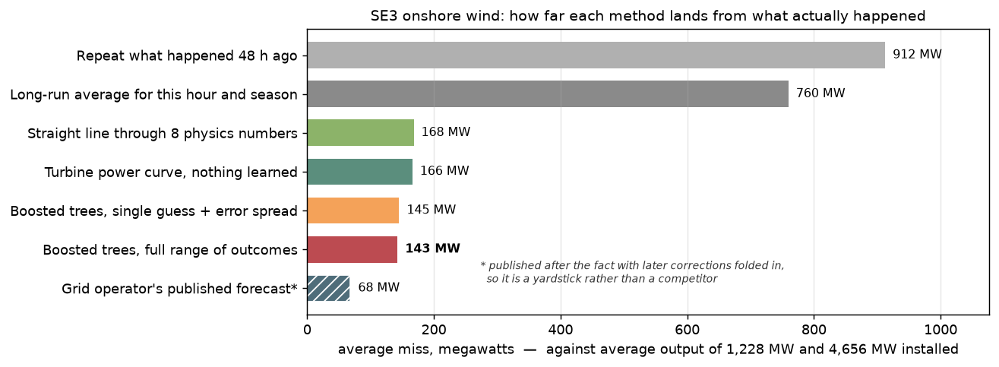
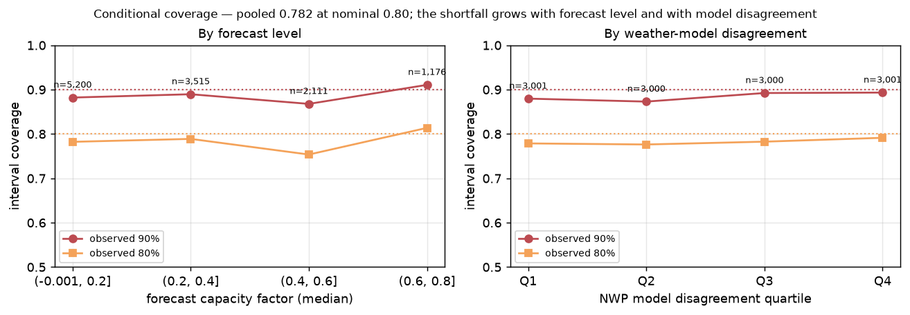
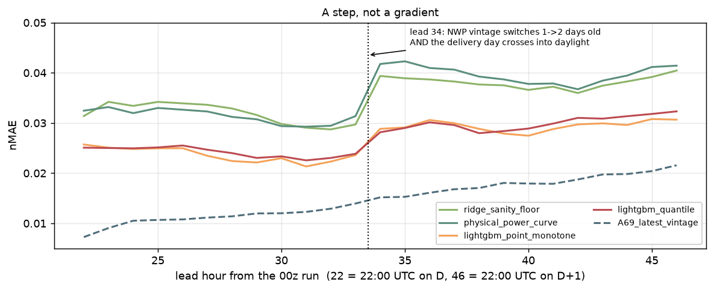
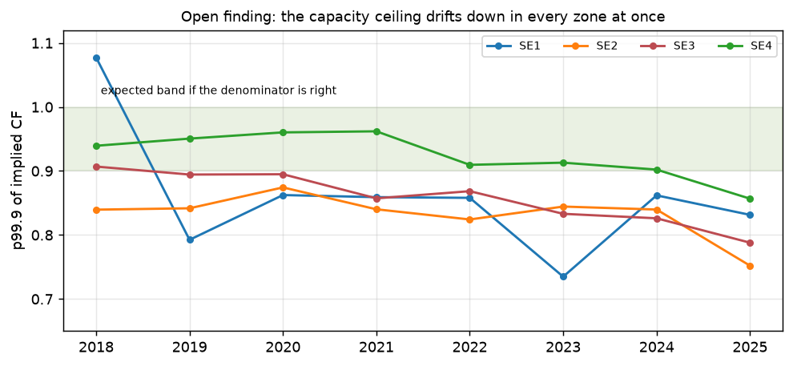

# Day-ahead wind and solar forecasting

Electricity for tomorrow is bought and sold today. Bidding for a given day closes at
midday the day before, so everyone trading has to guess how much wind and solar will
actually generate over the 24 hours that follow. Wind is the least predictable part of
the supply, which makes it the hardest part of that guess to get right.

This project builds that guess. Every morning it takes the overnight weather forecast,
converts it into expected generation for each hour of tomorrow, and reports not just a
single number but a **range**: how much output is likely, and how confident we should be.
It currently covers **onshore wind in SE3** (central Sweden). Solar is planned and not
yet started.

| | where it stands |
|---|---|
| **Wind, SE3** | Working. Typical miss **143 MW** per hour against 4,656 MW installed |
| **Solar** | Not started. Only the data checks are done |



---

## What a forecast looks like

Here is tomorrow, made this morning. Nothing has happened yet, so there is nothing to
compare it against — this is the actual product:



The dark line is the single most likely output for each hour. The shaded bands say how
uncertain that is: the darkest covers the middle half of plausible outcomes, the palest
covers all but the most extreme 10%. A wide band means the weather is genuinely hard to
call that hour; a narrow one means we expect to be close.

This forecast says the wind drops away through the night and stays low all day — from
about 1,800 MW at midnight down to roughly 200 MW by lunchtime.

And here is the same method on four days from the past, where we *can* check it. The
days are picked by rank, not by hand — an average day, a poor one, the worst in the
whole period, and the windiest:



---

## How good is it



Each bar is a different method, all measured the same way: run it on eighteen months of past
days it was never trained on, and see how far it lands from what actually happened.

| method | what it actually does |
|---|---|
| Repeat what happened 48 h ago | Yesterday's generation, copied forward. The crudest possible guess |
| Long-run average | The average output for this hour of the day and time of year, ignoring the weather entirely |
| Straight line through 8 physics numbers | A simple linear formula over forecast wind speed, the turbine power curve, and the time of year |
| Turbine power curve, nothing learned | Pure physics: take forecast wind speed at each of 8 locations across SE3, push it through a manufacturer-style power curve, weight by how much capacity sits near each location. No fitting at all |
| Boosted trees, single guess + spread | A machine-learning model (LightGBM) over 87 inputs, predicting one number, with the uncertainty estimated separately afterwards |
| Boosted trees, full range of outcomes | The same model family, but trained to predict the whole range directly. **This is what the project ships** |
| Grid operator's published forecast | Svenska kraftnät's own numbers, for reference only — see the caveat below |

The 87 inputs are mostly forecast weather at 8 points spread across the zone, from three
independent weather models, plus how much those models disagree with each other, how the
weather is changing hour to hour, the time of year, and what the fleet generated two or
more days ago.

**Three things are worth noticing.**

Physics alone gets you most of the way. A power curve with nothing learned lands at
166 MW; the machine-learning model takes that to 143 MW. Real, and worth having, but
this is a physics problem with a statistical correction on top — not a problem machine
learning solves by itself.

Weather-blind methods are hopeless. Guessing from the seasonal average misses by 760 MW,
five times worse. That gap is the whole value of using a weather forecast at all.

**The grid operator's number is not a fair comparison.** It looks far better than
everything else, at 68 MW. It should not be: published research puts realistic day-ahead
wind forecasting in the 140–280 MW range for a zone this size. The reason is that the
public data archive serves the *latest revised version* of that forecast, with
corrections folded in after the fact, and offers no way to retrieve what was actually
published before bidding closed. So it is a yardstick for how good this could eventually
get, not a competitor we are losing to.

---

## What is wrong with it

### 1. When we say 80% sure, we are right 74% of the time

The forecast claims a range it expects the truth to fall inside 80% of the time. Across
13,082 hours the truth actually landed inside it 74% of the time. The ranges are too narrow
— the model is more confident than it has earned.

That gets worse exactly where it matters most:



On low-wind hours the ranges are roughly honest. On high-wind hours — when generation is
large, prices swing hardest, and being wrong is most expensive — they are noticeably too
tight. The model does widen its ranges as output rises, but not nearly enough.

The worst single day in the whole period, 13 February 2026, shows what this costs. The forecast
said around 1,800 MW; actual output was near 1,200 MW and fell to 500 MW. It was wrong by
about 520 MW for twenty-four hours straight, and the truth sat outside the stated range
in every hour but one. The forecast gave no warning at all: its range that day was no
wider than on any ordinary day. The model was not uncertain. It was confidently mistaken.

### 2. Half of each day is forecast from older weather data than it needs to be



Error is flat through the first half of the delivery day, jumps **35% in a single hour**,
then is flat again. That jump is not the weather getting harder to predict. It is an
artefact of how we obtain the weather data.

The weather archive we use can only be asked for values *as they stood a whole number of
days before the time being forecast* — one day before, two days before, and so on. It
cannot be asked for a specific weather model run.

We make our forecast at 10:00 market time for a day running 00:00 to 24:00 the next day.
So the earliest hours of that day are 14 hours ahead of us, and the latest are 38 hours
ahead. For the early hours, "as it stood one day earlier" is information that already
existed when we forecast — fine. For the later hours, "as it stood one day earlier" would
be information published *after* we made our forecast. We cannot use it without cheating,
so those hours have to fall back to two-days-earlier data instead.

The result is that the back half of every delivery day is forecast using weather
information a full day staler than the overnight run we actually had in hand. A
controlled test confirms this is the cause rather than time of day: deliberately feeding
the stale data to the *first* half of the day too makes its error jump by 45%, matching
the second half, while the second half does not move.

### 3. A basic sanity check on installed capacity does not pass

We express generation as a share of installed capacity, so we need to know how many
megawatts of turbines exist on any given date. The standard check is to look at the
highest output ever reached in a rolling window: if the capacity figure is right, the
fleet should occasionally come close to it, and that ratio should stay roughly flat over
the years.



It does not. It falls steadily, from 0.91 in 2018 to 0.79 in 2025, and all four Swedish
zones fall together. Something is systematically off between reported generation and
reported capacity, and we do not yet know what. Two obvious explanations have been
tested and ruled out: it is not turbines being switched off when prices go negative, and
it is not the fleet spreading over a wider area. This matters because a drifting
denominator quietly distorts every percentage in this document.

### 4. The market trades 15-minute blocks; this forecast is hourly

Since 1 December 2025 the Swedish bidding zones report generation in 15-minute periods,
following the move to 15-minute market settlement. This project averages that up to
hourly and forecasts hourly. That was the right simplification to start with, but it means the output is not
yet in the units the market actually trades.

---

## What comes next, in order

1. **Get weather data addressed by model run** rather than by whole days, removing
   problem 2. MET Norway publishes an archive in exactly that form, and it would also
   supply the 30-member forecast spread that would help with problem 1.
2. **Fix the over-confidence** in problem 1.
3. **Explain the capacity drift** in problem 3.
4. **Move to 15-minute resolution** to match the market.
5. **Start solar**, on Germany rather than Sweden — Swedish rooftop solar is largely
   invisible in the published data, while German grid operators publish a properly
   estimated total.

Two deliberate omissions: a six-month slice of recent data (March–September 2026) has
been set aside untouched, to be used once for a final honest score, and no effort has
gone into tuning the model's settings, because with only two years of data that buys
flattering numbers rather than better forecasts.

---

## Reference

### Where the numbers come from

Every figure here is generated from the outputs of the backtest itself, so a chart
cannot drift away from the number it illustrates. Headline results cover **546 delivery
days, 13,082 hours**, between September 2024 and March 2026 — see `docs/metrics.md` for
exactly which rows each statistic covers and what it measures.

| document | what it settles |
|---|---|
| `docs/metrics.md` | what every number means, and which days it covers |
| `docs/dataflow.md` | where the data comes from and what is known when |
| `reports/data_audit.md` | which data is trustworthy enough to model |
| `reports/protocol.md` | the scoring rules, frozen before any model was built |
| `reports/openmeteo_vintage.md` | the weather-data timing problem in detail |
| `reports/modelling.md` | full results, all metrics |
| `reports/meps_archive.md` | whether better weather data is obtainable |
| `docs/integration_contract.md` | how this would plug into `grid-signals` |

### Progress

| Phase | State |
|---|---|
| 1 — dataflow diagram + scaffold | done |
| 2 — data audit | done — GO for SE3 wind |
| 3 — targets, frozen scoring rules, baselines | done |
| 4 — weather feature pipeline | done |
| 5 — modelling | done |
| 6 — ensemble spike | done — worth doing, not free |
| 6 — German solar | not started |
| 7 — integration contract | drafted |
| 7 — live trial run | not started |

### Rules the code holds to

- **All times are stored in UTC.** Local market time appears only when defining which
  hours belong to a delivery day, and in the charts.
- **Nothing becomes an input unless it was knowable at 10:00 market time on the day the
  forecast is made.** Every input column records how old its information is, and a test
  fails the build if any of them is too fresh. This is the most important test here — it
  caught a real defect the first time it ran.
- **Never use a weather provider's automatic "best model" blend.** What it blends changes
  over time, which a model would learn as if it were weather.
- **Errors are measured against installed capacity, not average output**, so they stay
  comparable across years as the fleet grows.
- **Every number in a report comes from a function in `src/`**, so it can be re-derived.

### Layout

```
docs/      dataflow.md, metrics.md, integration_contract.md
configs/   base.yaml + experiments/ deep-merged on top
src/renewable_forecast/
  windows.py   issue times, delivery days, lead hours
  config.py    YAML load, deep merge, run fingerprint
  paths.py     every filesystem path, in one place
  store.py     parquet source of truth, DuckDB views over it
  sources/     ENTSO-E, Open-Meteo, the Swedish turbine registry
  targets/     what we are predicting, and the capacity denominator
  features/    weather to power conversion, and the design matrix
  evaluation/  splits, metrics, baselines
  models/      the forecasters themselves
  pipelines/   build, train, backtest, predict
  reporting/   every figure, generated from backtest outputs
notebooks/ exploration only -- may import from src/, never the reverse
tests/     time alignment, information-age guards, figure integrity
reports/   committed markdown + figures
data/      gitignored
mlruns/    gitignored (MLflow, SQLite backend)
```

### Running it

```bash
uv sync --group research
export PYTHONPATH=research/src

uv run python -m renewable_forecast.pipelines.data_audit   # data quality gate
uv run python -m renewable_forecast.pipelines.train        # backtest + results
uv run python -m renewable_forecast.pipelines.predict      # forecast tomorrow
uv run python -m renewable_forecast.reporting.figures      # regenerate every figure
uv run mlflow ui --backend-store-uri sqlite:///research/mlruns/mlflow.db

uv run pytest research/tests
```

The research dependencies are an opt-in group, so a plain `uv sync` keeps the
`grid-signals` environment lean. `research/` shares the root `pyproject.toml` rather
than being an installed package, which is why `PYTHONPATH` is needed outside pytest.
