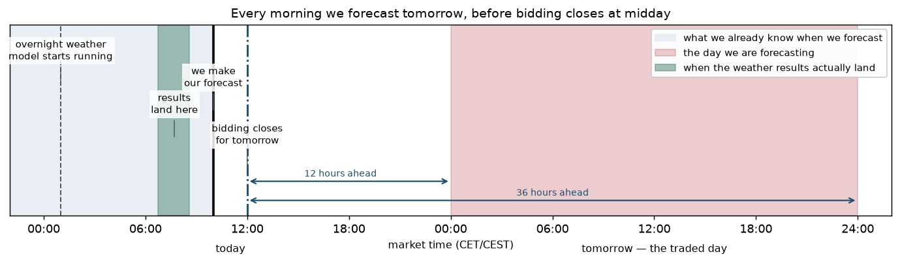
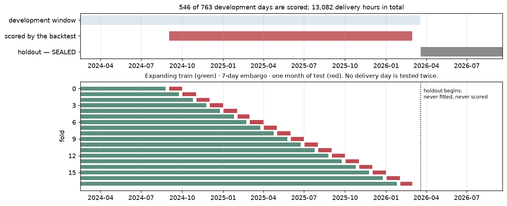

# Dataflow — day-ahead VRE forecasting

**Status:** living document. Amend whenever the pipeline shape changes; this is the shared mental
model the rest of the project is written against.

Scope: the initial probabilistic renewable-forecasting pipeline, with **SE3 wind**
and **DE-LU solar** as the existing research cases. Research inputs/models remain
under `research/`; completed results are now exported to the read-only Streamlit
demo. The [publication contract](integration_contract.md) defines timing and
reliability semantics; a database/API feed is not part of the target architecture.

The [project roadmap](../../ROADMAP.md) owns regional expansion priorities. The
[target architecture](../../docs/implementation-plan.md) consolidates reusable
forecasting code and retires the original PostgreSQL market application. The diagrams
and timing below describe the original task; broader market-day and product
contracts need explicit treatment when their roadmap milestones are reached.

---

## 1. The forecast task in time

The whole project hinges on one boundary: what is knowable at issue time. Everything else is
plumbing.



```
  ───── day D-1 ─────┼──────────────── day D ────────────────┼───── day D+1 ─────▶
                     │                                       │
   23:00 UTC         │   00z      09:00 UTC     10:00 (CEST) │  00:00 ······ 24:00
   last actual we    │   run      ISSUE TIME    11:00 (CET)  │  local         local
   may use ──────────┤    │           │         gate closure │  ╰─ DELIVERY DAY ─╯
                     │    │           │                      │   23 / 24 / 25
                     │    └───────────┴─── +22 … +47 h ──────────▶ hourly targets
                     │                                       │   expressed in UTC
```

Frozen in `configs/base.yaml`:

| Parameter | Value | Why |
|---|---|---|
| Issue time | **09:00 UTC** | Gate closure is 12:00 local = 11:00 UTC winter but **10:00 UTC summer**. 09:00 keeps ≥1 h slack year-round. |
| NWP run | **00z of day D, explicitly** | Never "latest available" — that is how train/serve skew creeps in. |
| Lead window | **+22 … +47 h** | Interval *starts* span +22…+46 (+23…+46 under CET, +22…+45 under CEST); the last interval ends at +47. Verified by `test_lead_hours_stay_within_the_frozen_window`. |
| Target grid | hourly UTC, left-labelled | 23/24/25 targets per delivery day depending on DST. |
| Resolution | config param, default `1h` | Market MTU is now 15-min; the eventual product must follow. |

---

## 2. The known / not-known boundary

```
┌─────────────────────────────────────┬─────────────────────────────────────┐
│  KNOWN AT 09:00 UTC, DAY D          │  NOT KNOWN — never use as a feature │
│  ─────────────────────────          │  ──────────────────────────────────  │
│  NWP 00z run of day D               │  actuals after 23:00 UTC of D-1     │
│    leads +22…+47 h                  │  revised A75 values                 │
│    4-5 pinned providers             │  latest-vintage A69                 │
│  Actuals up to 23:00 UTC of D-1     │  `best_match` blends (composition   │
│  Fleet / installed capacity as-of D │    changes over time → silent        │
│  Calendar                           │    non-stationarity)                │
│                                     │  capacity only knowable later       │
└─────────────────────────────────────┴─────────────────────────────────────┘
```

Enforced mechanically: every feature column carries a `max_source_time`, and the leakage test asserts
`max_source_time <= issue_time` for every column in the assembled design matrix. This is the most
important test in the project.

---

## 3. Pipeline

```
  SOURCES                     PARSED                DERIVED                 MODEL
  ───────                     ──────                ───────                 ─────

  ENTSO-E A75 actual ──┐
   (target)            │
                       ├──▶ parquet ──┬──────────────▶ target CF ──────┐
  ENTSO-E A68 capacity ┤              │                     ▲          │
                       │              └──▶ capacity series ─┘          │
  Vindbrukskollen ─────┘                     (denominator)             │
   (fleet registry)                                                    │
        │                                                              │
        └──▶ k-means, capacity-weighted ──▶ N cluster points           │
                                                 │                     │
                                                 ▼                     ▼
  Open-Meteo Previous Runs ──▶ parquet ──▶ ┌──────────────┐     ┌─────────────┐
   offsets 1,2 (+3 for spread)             │ power curve  │     │   DESIGN    │
   pinned: ecmwf_ifs025, gfs025, icon_eu   │              │     │             │
                                           │ air density  │     │   MATRIX    │
  ERA5 via CDS ─────────────▶ parquet ──▶  │ spatial std  ├────▶│ keyed by    │
   (physics fitting, ~10 yr)               │ clear-sky kt │     │ (issue_time,│
                                           │ icing flags  │     │  target_time│
  MEPS / thredds (Phase 6) ─▶ parquet ──▶  │ lags & ramps │     │  fuel_type) │
   (ensemble, if archive allows)           └──────────────┘     └──────┬──────┘
                                                                       │
                                                                       ▼
                                                              ┌────────────────┐
                                                              │ quantile GBM   │
                                                              │ + conformal    │
                                                              │ + Schaake      │
                                                              └────────┬───────┘
                                                                       │
                                                                       ▼
  ENTSO-E A69 (TSO forecast) ─────────┐                        quantile forecast
  climatology / persistence ──────────┼──▶  EVALUATION  ◀───────  (CF and MW)
  physical power-curve baseline ──────┘          │
                                                 ▼
                                         MLflow run + metrics.parquet
```

### Why the physics sits where it does

The power-curve transform is applied **per cluster, then capacity-weighted** — never to the spatial
mean. The curve is convex below rated and concave above, so transforming the mean discards exactly
the spatial smoothing that makes zonal capacity factor far less peaky than point capacity factor.

The same applies to ensemble members once they exist: transform each member first, summarise after.

### Why ERA5 is still here

Physical transforms (power curve, air density, clear-sky index) are *deterministic functions*, not
fitted parameters, so they carry no train/serve skew. The split is:

- **ERA5, ~10 years** → fit the fleet-response physics and validate the chain (cross-checked against
  PECD `peon` SE03 capacity factors).
- **Matched-lead forecast archive, ~Jan 2024 onward** → fit only the thin statistical correction layer.

This is why ERA5 appears as an input to the derived-features box but not to the model box.

---

## 4. Storage

```
research/data/
  raw/<source>/<sha256-of-request>.json.gz    ← verbatim responses, never parsed in place
  raw/requests_ledger.parquet                 ← params → hash → fetch time
  parsed/<source>/model=/point=/year=/*.parquet
  interim/targets_se3.parquet
  features/design_matrix.parquet
  predictions/issue_date=YYYY-MM-DD/*.parquet ← append-only vintages
research/mlruns/                              ← MLflow local file backend
```

Parquet is the source of truth. DuckDB holds **views only** over parquet globs plus small dimension
tables — rebuildable in seconds by `store.rebuild_views()`, so it never needs backing up.

Raw responses are archived keyed by a hash of the request params, which means a parser bug costs zero
API calls to fix and every pull is resumable (compute the full request set, subtract the ledger,
fetch the remainder).

---

## 5. Evaluation flow

```
  full history
  ├─────────────────────────────────────────────────┬──────────────────┐
  │        rolling-origin, monthly origins          │  SEALED HOLDOUT  │
  │  ┌────────────┐ ▒▒ ┌────┐                       │   last 6 months  │
  │  │   train    │ ▒▒ │test│                       │  opened ONCE, at │
  │  └────────────┘ ▒▒ └────┘                       │  end of Phase 5  │
  │       ▒▒ = 7-day embargo                        │                  │
  └─────────────────────────────────────────────────┴──────────────────┘

  resampling unit = the DELIVERY DAY, never the hour
  (adjacent hours are ~0.95 correlated; effective n is the day count, ~630)
```

Metrics are normalised by **installed capacity, not mean generation** — mean-normalising makes
numbers incomparable across years as the fleet grows. Reported per lead hour and per season, since
drivers like icing are seasonal by nature.

Headline scalars go to MLflow; the full metric grid (metric × lead hour × season × CF quintile) goes
as a `metrics.parquet` artifact attached to the run, queried with DuckDB.



**The development window is not the scored window.** 217 of the 763 development days never appear in
a test fold — 199 at the start, before the first fold has its 180 training days, and 18 at the end,
after the last monthly origin. Every headline number is a mean over the remaining **546 days /
13,082 delivery hours**. Exact definitions and the MW translation: `docs/metrics.md`.

---

## 5b. The operational path

The backtest and the forecast share every feature function; they differ only in what they know.

```
  BACKTEST                                OPERATIONAL  (pipelines/predict.py)
  ────────                                ───────────
  assemble.build()                        assemble.build_operational(delivery_day)
    joins NWP to the target table           builds the delivery-day grid, no target
    cf is known                             cf does not exist yet
    capacity from the target row            capacity frozen at the issue day
         │                                       │
         ▼                                       ▼
  rolling-origin folds                    fit on ALL trainable days < delivery_day
  fit per fold, predict its test month    predict 19 quantiles
         │                                       │
         ▼                                       ▼
  data/predictions/backtest_*.parquet     data/predictions/forecast_vintages.parquet
  scored against the outturn              APPEND-ONLY; scored later, when actuals land
```

Both paths call `_annotate` and `required_offset`, so a delivery hour gets the same NWP vintage
either way — the leakage tests assert this, because a mismatch would be train/serve skew invisible
to the backtest.

The operational model fits on every day available at issue time, **including sealed-holdout days**.
That is correct for production and does not contaminate the holdout evaluation, which refits from
folds that exclude it — but it does mean the deployed model is never the model on the leaderboard.

---

## 6. Open questions this diagram will have to absorb

Tracked here so the diagram stays honest about what is not yet settled:

- **Open-Meteo Previous Runs lead-time semantics** — which run initialisation and lead hours does
  `<var>_previous_dayN` actually correspond to? Phase 4 sub-gate. If it cannot be pinned down, the
  MOS premise weakens and the ERA5 physics layer carries more weight.
- **MEPS retroactive archive depth** — determines whether a true 30-member ensemble track exists in
  v1 at all. Phase 6 spike.
- **SE3 offshore materiality** — if immaterial, the `wind_offshore` box merges into a single `wind`
  target.
- **A69 vintage recoverability** — if publication time cannot be recovered, the benchmark is renamed
  `A69_latest_vintage` and treated as optimistic.
- **DE-LU solar** — is A75 really upscaled total feed-in (consistent with netztransparenz/SMARD), or
  metered-only?

---

## Changelog

| Date | Change |
|---|---|
| 2026-09-21 | Forecasts, not just scores. `pipelines/predict.py` produces an operational forecast for a delivery day with no actuals, via `assemble.build_operational`; the backtest now persists every forecast row. Four new figures: the latest forecast, backtest days against outturn, the evaluation window, and a corrected task-horizon diagram. `docs/metrics.md` states what each metric measures and over which 546 days / 13,082 hours. Corrected: the task-horizon figure had drawn run-relative leads (+22…+47) on an issue-relative axis; the market frame is 12-36 h from gate closure, and all three reference points are now marked on one clock. |
| 2026-09-21 | Vintage ablation (`pipelines/ablate_vintage.py`). Forcing `nwp_offset_days = 2` onto every lead hour raises leads 22-33 from 0.0259 to 0.0376 nMAE while the already-offset-2 back half does not move — so the step at lead 34 is the NWP vintage, not the day/night boundary, and at equal vintage night is slightly *harder* than day. Estimated headroom from a run-addressed archive: overall nMAE ~0.025 against today's 0.0307. |
| 2026-09-21 | Reporting pass. Figures moved into `src/renewable_forecast/reporting/figures.py` so every chart is generated from the backtest's own artifacts, and a test now asserts that every embedded figure path resolves — four figures had been rendering broken. Two findings the prose had hidden: error against lead time is a **step at lead 34**, not a gradient, tracking the `previous_day1`→`previous_day2` vintage switch; and the capacity-factor ceiling **drifts down in all four Swedish zones at once**, with curtailment and fleet spread both tested and rejected as causes. `research/README.md` added as the one-page state of play. |
| 2026-09-20 | Initial version — task definition, known/not-known boundary, pipeline, storage, evaluation. |
| 2026-09-20 | Phases 5-7: models scored, conformal calibration added after the coverage column exposed in-sample residual estimation (0.327 coverage at nominal 0.80 for the boosted point model). MEPS spike returned conditional GO — a real 30-member archive back to 2016, but the product mix drifts across eras. Integration contract drafted. |
| 2026-09-20 | Phase 4: NWP pipeline built. The leakage guard rejected the obvious construction — a fixed `previous_day1` offset leaks on 13 of every 24 delivery hours — so the design matrix now picks the smallest *safe* offset per hour and carries `nwp_offset_days`. Minimum safe lag for actuals raised 24 h → 48 h for the same reason. Archive depth is shorter than planned: 2024-03 onward, three usable models, ~946 delivery days. |
| 2026-09-20 | Phase 3: protocol frozen (`reports/protocol.md`), baselines scored. A69 turns out not to be a usable day-ahead bar — 1.77% nMAE, 3-4x better than published day-ahead skill — so climatology, persistence and the physical baseline carry the comparison. Two silently-vacuous quality checks found and fixed. |
| 2026-09-20 | Phase 2 audit landed. Resolved: SE3 offshore is absent from A75 (drop it); A68 is national for Sweden so the zonal denominator comes from Vindbrukskollen; A69 vintage is not recoverable, benchmark renamed `A69_latest_vintage`; SE zones went 15-minute on 2025-12-01. SE3 solar moved from assumed-unusable to CONDITIONAL — the series is credible, only the denominator is missing. |
