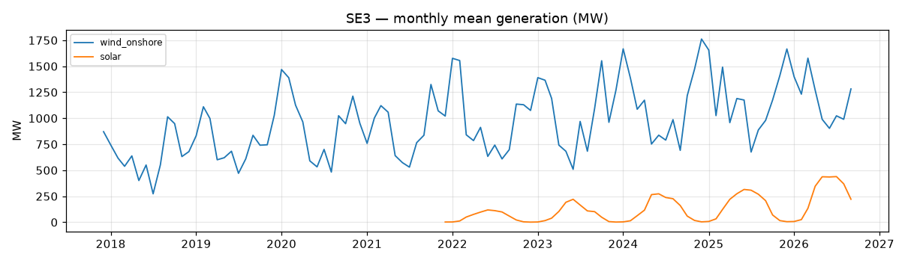
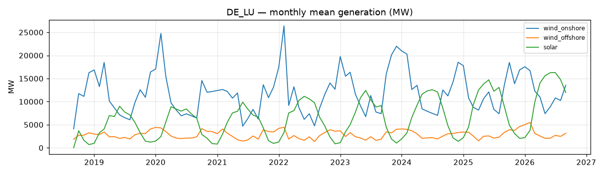
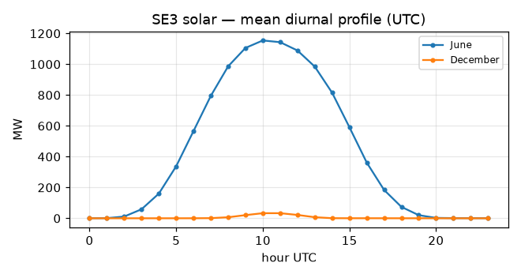
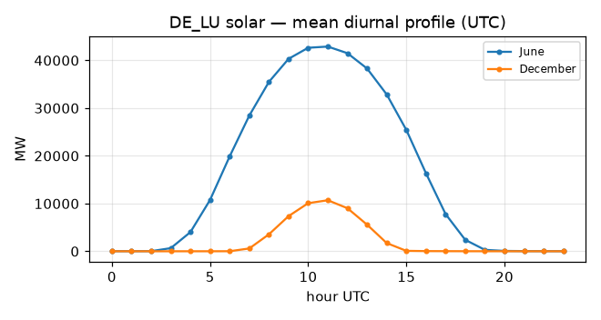
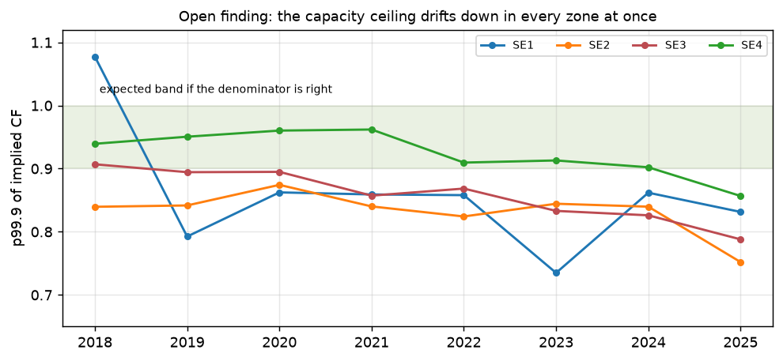

# Phase 2 — Data audit

**Generated:** 2026-09-21 · **Span:** 2017-12-31 → 2026-09-19 · **Source:** ENTSO-E
Transparency Platform, pulled into `research/data/raw/entsoe/`.

This is the hard gate: no modelling code until the verdicts below are recorded.
Regenerate with `PYTHONPATH=research/src uv run python -m renewable_forecast.pipelines.data_audit`.

## Verdicts

| Target | Verdict | Basis |
|---|---|---|
| SE3 onshore wind | **GO** | A75 coverage 99.5% since 2021, longest stale run 3 h |
| SE3 solar | **CONDITIONAL** | series is physically credible, but **no zonal capacity denominator exists** — see Check F |
| DE-LU solar | **GO** | shape checks pass; peak/installed = 0.56 |

Per the project scope, solar development proceeds on **DE-LU**. SE3 solar is recorded as
CONDITIONAL rather than NO-GO — the blocker is the normalisation denominator, not the
target series itself, and it becomes tractable if a zonal PV capacity estimate is found.

## Check A — Target integrity

| zone | fuel | first_month | cov%_2021+ | peak_mw | A68_mw | peak/A68 | const_run_h |
|---|---|---|---|---|---|---|---|
| DE_LU | wind_onshore | 2018-09 | 99.46 | 48682.44 | 67922.93 | 0.72 | 1 |
| DE_LU | wind_offshore | 2018-09 | 99.46 | 8448.34 | 9226.42 | 0.92 | 2 |
| DE_LU | solar | 2018-09 | 99.46 | 58360.13 | 104029.51 | 0.56 | 4 |
| SE1 | wind_onshore | 2017-12 | 99.46 | 3162.31 | 18000.00 | 0.18 | 4 |
| SE1 | solar | 2021-12 | 98.58 | 20.07 | 5000.00 | 0.00 | 10 |
| SE2 | wind_onshore | 2017-12 | 99.46 | 6685.43 | 18000.00 | 0.37 | 3 |
| SE2 | solar | 2021-12 | 98.58 | 89.16 | 5000.00 | 0.02 | 12 |
| SE3 | wind_onshore | 2017-12 | 99.46 | 3854.46 | 18000.00 | 0.21 | 3 |
| SE3 | solar | 2021-12 | 98.58 | 1671.88 | 5000.00 | 0.33 | 16 |
| SE4 | wind_onshore | 2017-12 | 99.46 | 2055.65 | 18000.00 | 0.11 | 3 |
| SE4 | solar | 2021-12 | 98.58 | 856.54 | 5000.00 | 0.17 | 13 |

`A68_mw` is ENTSO-E installed capacity. **A68 is published per country for Sweden, not
per bidding zone** — `SE_1`…`SE_4` all return `NoMatchingDataError` — so SE rows compare
a single-zone peak against the *national* fleet and `peak/A68` is expected to sit well
below 1. DE-LU is simultaneously a country and a bidding zone, so its ratio is directly
interpretable. Consequence for Phase 3: the capacity *level* anchor for SE3 must come
from Vindbrukskollen, with A68 usable only as a national sanity check.

## Check B — Offshore materiality

| zone | onshore_peak_mw | offshore_peak_mw | offshore_share | material |
|---|---|---|---|---|
| DE_LU | 48682.44 | 8448.34 | 0.17 | True |
| SE1 | 3162.31 | 0.00 | 0.00 | False |
| SE2 | 6685.43 | 0.00 | 0.00 | False |
| SE3 | 3854.46 | 0.00 | 0.00 | False |
| SE4 | 2055.65 | 0.00 | 0.00 | False |

## Check C — A69 day-ahead benchmark

| zone | fuel | first_month | months | cov%_2021+ | enough |
|---|---|---|---|---|---|
| DE_LU | solar | 2018-09 | 97 | 99.46 | True |
| DE_LU | wind_offshore | 2018-09 | 97 | 99.46 | True |
| DE_LU | wind_onshore | 2018-09 | 97 | 99.46 | True |
| SE1 | solar | 2021-12 | 58 | 98.86 | True |
| SE1 | wind_onshore | 2017-12 | 106 | 99.08 | True |
| SE2 | solar | 2021-12 | 58 | 98.86 | True |
| SE2 | wind_onshore | 2017-12 | 106 | 99.08 | True |
| SE3 | solar | 2021-12 | 58 | 98.86 | True |
| SE3 | wind_onshore | 2017-12 | 106 | 99.08 | True |
| SE4 | solar | 2021-12 | 58 | 98.86 | True |
| SE4 | wind_onshore | 2017-12 | 106 | 99.08 | True |

**Vintage limitation.** The Transparency Platform serves the *latest revision* for a
target time, and `entsoe-py` exposes no publication timestamp. A69 is therefore recorded
as `A69_latest_vintage` throughout this project: it is an **optimistic** benchmark, and
no claim of beating it is valid without this caveat attached.

## Check D — 15-minute settlement transition

| zone | first_15min_timestamp |
|---|---|
| DE_LU | 2018-09-30 22:15:00+00:00 |
| SE1 | 2025-12-01 23:15:00+00:00 |
| SE2 | 2025-12-01 23:15:00+00:00 |
| SE3 | 2025-12-01 23:15:00+00:00 |
| SE4 | 2025-12-01 23:15:00+00:00 |

## Check E — DST / delivery-day integrity

| year | days_23h | days_24h | days_25h | ok |
|---|---|---|---|---|
| 2018 | 1 | 363 | 1 | True |
| 2019 | 1 | 363 | 1 | True |
| 2020 | 1 | 364 | 1 | True |
| 2021 | 1 | 363 | 1 | True |
| 2022 | 1 | 363 | 1 | True |
| 2023 | 1 | 363 | 1 | True |
| 2024 | 1 | 364 | 1 | True |
| 2025 | 1 | 363 | 1 | True |
| 2026 | 1 | 363 | 1 | True |
| 2027 | 1 | 363 | 1 | True |

Each year must contain exactly one 23-hour and one 25-hour delivery day. This is
asserted independently in `research/tests/test_windows.py`.

## Check F — Solar feasibility

Shape checks need no capacity denominator and test whether the series is physically
credible. The level check (`peak/A68`) needs a *zonal* denominator, which exists only
for DE-LU — Swedish A68 is national, so those cells are left blank rather than
populated with a misleading national ratio.

| zone | peak_mw | zonal_A68_mw | peak/A68 | summer/dec | night/peak |
|---|---|---|---|---|---|
| DE_LU | 58360.13 | 104029.51 | 0.56 | 10.29 | 0.00 |
| SE1 | 20.07 | — | — | 1888.08 | 0.00 |
| SE2 | 89.16 | — | — | 318.04 | 0.00 |
| SE3 | 1671.88 | — | — | 93.06 | 0.00 |
| SE4 | 856.54 | — | — | 46.58 | 0.00 |

## Check G — Fleet registry cross-check

Implied capacity-factor ceiling (yearly **p99.9** of observed MW ÷ Vindbrukskollen
capacity) per Swedish zone. If the denominator tracks the fleet this sits flat inside
roughly 0.90-1.00. It does not — see the open finding below the table.

Note the statistic: the *maximum* implied factor exceeds 1.0 for SE1 and SE2 in 2022,
which looks alarming and is not. A single hour is enough to break it — a metering spike,
or a wind farm whose registry commissioning date lags its actual grid connection. The
p99.9 removes that and lands every zone-year in the plausible band. This is why the
denominator diagnostic is specified as p99.9 rather than max.

| year | SE1 | SE2 | SE3 | SE4 |
|---|---|---|---|---|
| 2018 | 1.08 | 0.84 | 0.91 | 0.94 |
| 2019 | 0.79 | 0.84 | 0.89 | 0.95 |
| 2020 | 0.86 | 0.87 | 0.89 | 0.96 |
| 2021 | 0.86 | 0.84 | 0.86 | 0.96 |
| 2022 | 0.86 | 0.82 | 0.87 | 0.91 |
| 2023 | 0.73 | 0.84 | 0.83 | 0.91 |
| 2024 | 0.86 | 0.84 | 0.83 | 0.90 |
| 2025 | 0.83 | 0.74 | 0.79 | 0.86 |
| 2026 | 0.81 | 0.78 | 0.77 | 0.78 |

Nationally the registry totals 18,198 MW of operational onshore wind against ENTSO-E
A68's 18,000 MW for SE — agreement to 1.1%, which validates the registry on *level* as
well as timing.

**Open finding: the ceiling is not flat.** Every zone drifts down together — SE3 from
0.91 in 2018 to 0.79 in 2025, and SE1, SE2 and SE4 by a similar margin. A simultaneous
drift in four independent zones rules out a boundary or zone-assignment error. Two
further explanations have been tested and rejected:

- **Curtailment.** Recomputing p99.9 over non-curtailed hours only moves the SE3
  statistic by 0.001 in every year, even in 2024 when 8.6% of hours carried the flag.
- **Fleet spread.** A geographically wider fleet has a lower zonal peak. But the SE3
  capacity-weighted RMS spread *narrowed* from 175 km to 159 km over the period, which
  pushes the ceiling up, not down.

The registry also agrees with A68 nationally to within a few percent in every year, so
a simple over-count is not the explanation either. What remains is A75 under-reporting a
growing fleet, or commissioning dates that lead grid connection by a widening margin.
Unresolved, and it matters: roughly 7% of the drift falls inside the modelling window,
against a model error of 3%.

