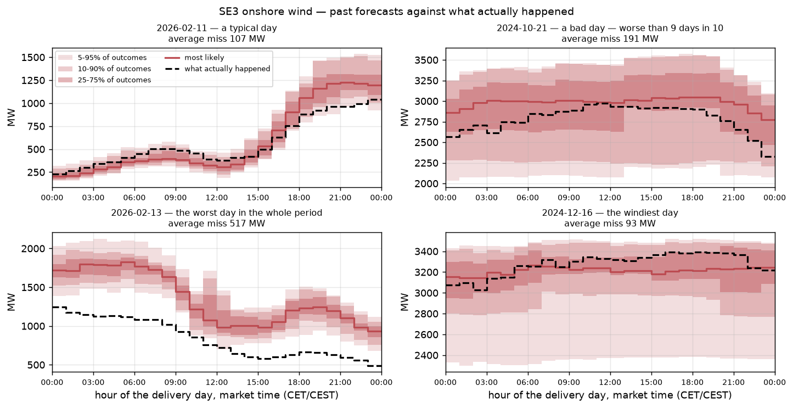
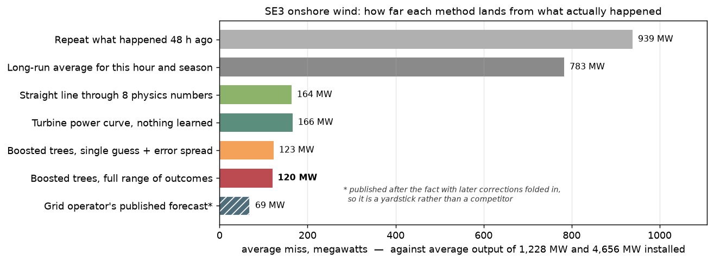
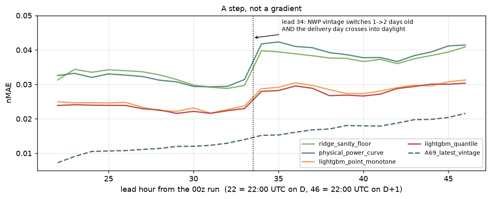
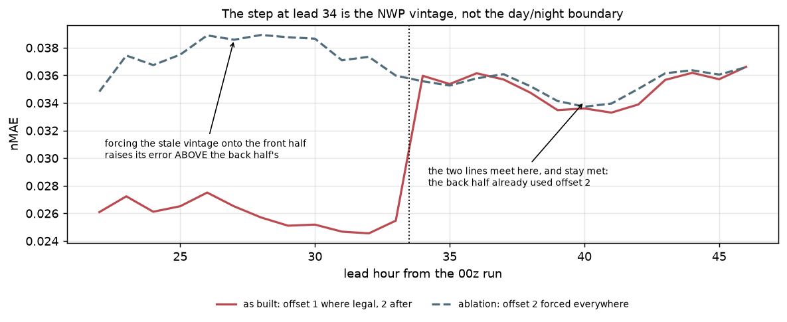
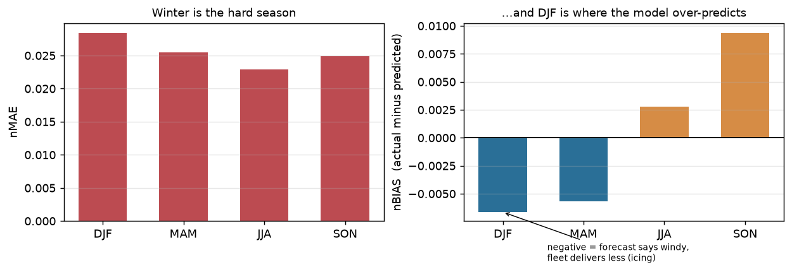
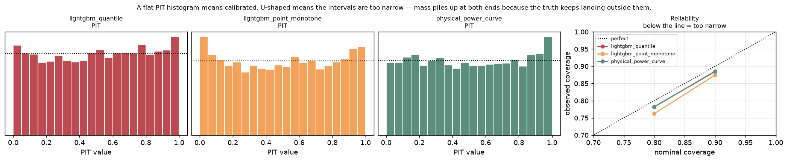
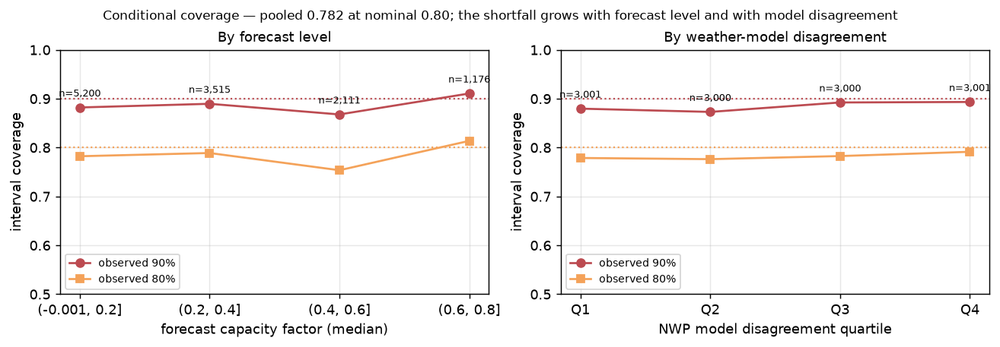

# Phase 5 — Modelling

**Run 2026-09-20, development set only.** The 184-day holdout (2026-03-20 → 2026-09-19)
is **sealed** and is not reported here. 18 rolling-origin folds over 763 development
days, 7-day embargo, resampled by delivery day, on the frozen protocol in
`protocol.md`. All metrics normalised by installed capacity.

**What the metrics mean and which rows they cover:** `docs/metrics.md`. In short, every
number below is a mean over the same 13,082 delivery hours — 546 days between
2024-09-02 and 2026-03-01, each appearing in exactly one test fold.

## Leaderboard v2 — run-addressed weather (2026-09-22)

The configured feature set now adds MET Norway MEPS and ECMWF IFS HRES, both addressed
by model run (`configs/base.yaml: features.run_addressed`). The calibration layer is
`SpreadCQR` fitted on cross-fitted residuals (`reports/calibration.md`). Scored on the
days that have every source: **17 folds, 501 delivery days, 12,002 hours,
2024-10-02 → 2026-03-01**. That window is slightly shorter than v1's, so compare within
this table. It also includes the fix for missing weather values being averaged into
zero wind (`features/wind.py`, `aggregate`).

| forecaster | nMAE | nRMSE | nBIAS | CRPS | cov@80 | cov@90 | sharp@80 | CRPSS vs clim. |
|---|---|---|---|---|---|---|---|---|
| *A69_latest_vintage* | *0.0148* | *0.0245* | *0.0002* | *0.0119* | 0.764 | 0.873 | 0.040 | *+0.902* |
| **lightgbm_quantile** | **0.0258** | 0.0352 | 0.0000 | **0.0196** | 0.782 | 0.885 | 0.082 | **+0.839** |
| lightgbm_point_monotone | 0.0264 | 0.0359 | −0.0003 | 0.0205 | 0.762 | 0.874 | 0.078 | +0.831 |
| ridge_sanity_floor | 0.0352 | 0.0467 | 0.0012 | 0.0268 | 0.767 | 0.881 | 0.104 | +0.778 |
| physical_power_curve | 0.0357 | 0.0479 | 0.0036 | 0.0272 | 0.782 | 0.885 | 0.107 | +0.776 |
| climatology | 0.1682 | 0.2156 | 0.0697 | 0.1211 | 0.750 | 0.847 | 0.465 | 0.000 |
| persistence | 0.2016 | 0.2551 | 0.0012 | 0.1471 | 0.761 | 0.882 | 0.514 | −0.215 |

Against v1's shipping model: nMAE 0.0307 → 0.0258 (143 → 120 MW), CRPS 0.0232 →
0.0196, 80% coverage 0.737 → 0.782. Machine learning now earns **28%** CRPS over the
physical baseline, against 15% before. Of the gain, run-addressed weather accounts for
nMAE 0.0307 → 0.0271, cross-fitted calibration for 0.0271 → 0.0262, and the
missing-value fix for 0.0262 → 0.0258. The physics baselines still read only the
Open-Meteo block, so their lead curve keeps the full step at 34. The quantile model's
step is about +20%.

Everything below this section describes **v1** (Open-Meteo only, 2026-09-20) and is
kept as the record it was.

## What the forecasts look like



Four delivery days picked by rank, not by hand: the day nearest the median daily error,
the day nearest the 90th percentile, the worst day in the scored window, and the
windiest. The leaderboard below compresses all of this into eight numbers, and the
compression hides whether a day is forecast as a *sensible shape* — which is what these
panels show and no summary statistic can.

## Leaderboard



| forecaster | nMAE | nRMSE | nBIAS | CRPS | cov@80 | sharp@80 | CRPSS vs clim. |
|---|---|---|---|---|---|---|---|
| *A69_latest_vintage* | *0.0147* | *0.0242* | *0.0000* | *0.0118* | 0.769 | 0.041 | *+0.900* |
| **lightgbm_quantile** | **0.0307** | 0.0418 | −0.0026 | **0.0232** | 0.737 | 0.090 | **+0.804** |
| lightgbm_point_monotone | 0.0312 | 0.0421 | −0.0019 | 0.0241 | 0.765 | 0.093 | +0.796 |
| physical_power_curve | 0.0357 | 0.0481 | 0.0039 | 0.0272 | 0.778 | 0.107 | +0.770 |
| ridge_sanity_floor | 0.0361 | 0.0475 | −0.0039 | 0.0273 | 0.768 | 0.104 | +0.769 |
| climatology | 0.1632 | 0.2081 | 0.0579 | 0.1182 | 0.743 | 0.455 | 0.000 |
| persistence | 0.1960 | 0.2500 | 0.0010 | 0.1428 | 0.784 | 0.521 | −0.208 |

Every learned model beats climatology significantly (day-block bootstrap on the CRPS
difference, 2000 draws). Persistence is significantly *worse*, as expected at a 48-hour
lag. A69 is italicised because it is a reference, not a bar: ENTSO-E serves the latest
revision, which postdates gate closure. See `protocol.md`.

**Two readings of the board.** The sanity floor passes decisively — ridge on eight
physical features beats climatology by 76.9% CRPS, so nothing downstream is chasing a
pipeline bug. And machine learning earns 15% CRPS over the physical power-curve
baseline: real, significant, and modest. The feature importances say the same thing.

| feature | share of gain |
|---|---|
| power_curve_model_mean | 19.0% |
| power_curve_model_mean_shift−1 | 18.9% |
| power_curve_model_mean_shift+1 / −3 | 7.2% |
| wind_speed_100m_model_mean (+ shifts) | 9.8% |
| day-of-year terms | 4.6% |

## Error against lead time is a step, not a gradient



An earlier version of this report said error "grows with lead time, as it must" and
backed it with three coarse lead blocks (0.0263 / 0.0304 / 0.0348). The block averaging
hid the actual shape. Within leads 22–33 error is flat at ~0.026; within 34–46 it is flat
at ~0.035; the transition is a single-hour discontinuity of **+35%**.

Two things change at lead 34 simultaneously:

- **The NWP vintage.** Open-Meteo's Previous Runs API is addressable only in whole days.
  A valid time more than 24 h after the 09:00 UTC issue cannot use `previous_day1`
  without leaking, so `features/assemble.required_offset` correctly switches to
  `previous_day2` — a forecast 24 h older. Confirmed: the offset column flips from 1 to 2
  at exactly lead 34, with no overlap.
- **The clock.** Lead 34 is 10:00 UTC on the delivery day. Leads 22–33 are night and
  early morning; 34–46 are daylight, when boundary-layer mixing makes wind genuinely
  harder to forecast.

The two are perfectly collinear under a fixed issue time, so the leaderboard alone cannot
separate them. `pipelines/ablate_vintage.py` breaks the collinearity by forcing offset 2
onto *every* lead hour: leads 22–33 then carry the stale vintage at unchanged clock
hours, and leads 34–46 act as a control that should not move.



| forecaster | leads | as built | offset 2 forced | change |
|---|---|---|---|---|
| lightgbm_quantile | 22–33 | 0.0259 | **0.0376** | **+45%** |
| lightgbm_quantile | 34–46 | 0.0351 | 0.0354 | +0.8% (control) |
| physical_power_curve | 22–33 | 0.0315 | **0.0428** | **+36%** |
| physical_power_curve | 34–46 | 0.0396 | 0.0398 | +0.5% (control) |

The control behaves exactly as it must, and the front half degrades past the back half's
as-built level. **At equal vintage the night hours are slightly *harder* than the daylight
ones** (0.0376 against 0.0351), so the diurnal explanation is not merely secondary — it
has the wrong sign. The step is the vintage.

This is not leakage; the offset switch is the conservative choice and the leakage test
passes. It is *cost*, and the ablation sizes it. Applying the front half's
offset-1/offset-2 ratio (0.69) to the back half puts overall nMAE at roughly **0.025
against today's 0.0307** if the whole delivery day were served from one 00z run. That
extrapolation is worth more than the 15% machine learning earned over physics.

**Consequence.** Fixing it needs an NWP archive addressable by run initialisation rather
than by whole days. Probed and confirmed: Open-Meteo offers no such parameter
(`*_previous_run1` is rejected). MET Norway's MEPS archive is run-addressed, which
promotes `meps_archive.md` from an ensemble nice-to-have to the fix for the largest
measured structural error in the model.

## Winter is the hard season, and the bias says why



`nBIAS = mean(actual − predicted)`, so DJF's −0.0138 means the model **over-predicts** in
winter: the forecast says windy and the fleet delivers less. That is the signature of
icing — the NWP is right about the wind and wrong about what the turbines do with it. The
icing proxies in the feature set clearly do not capture it, which moves an explicit icing
model from "nice to have" to the largest identified residual.

## The calibration defect, and its fix



The first leaderboard was uncalibrated, and the coverage column diagnosed itself: the
tighter a model fitted its training data, the worse its intervals.

| forecaster | cov@80 before | after |
|---|---|---|
| lightgbm_point_monotone | **0.327** | 0.765 |
| lightgbm_quantile | 0.612 | 0.737 |
| ridge_sanity_floor | 0.762 | 0.768 |
| physical_power_curve | 0.784 | 0.778 |

Every dressed forecaster was estimating its residual distribution on the rows it had just
been fitted to, and in-sample residuals for a boosted tree are tiny and meaningless out
of sample. The physical baseline looked fine only because an affine correction cannot
overfit. Each training window now reserves its most recent quarter — split by whole
delivery days — for estimating spread, and the quantile model is conformalised on those
held-out days. The point model's CRPS *improved* as a result (0.0267 → 0.0241): honest
intervals score better, not worse.

### The pooled coverage hides where the intervals fail

Persisting the per-row forecasts made a breakdown possible that the metric grid could
not express: coverage conditioned on how much the fleet is actually producing.



| actual CF | n | cov@90 | cov@80 | mean p5-p95 width |
|---|---|---|---|---|
| 0.0-0.2 | 5,684 | 0.871 | 0.756 | 368 MW |
| 0.2-0.4 | 3,876 | 0.853 | 0.739 | 600 MW |
| 0.4-0.6 | 2,406 | 0.828 | 0.709 | 664 MW |
| 0.6-0.8 | 1,111 | 0.806 | 0.694 | 797 MW |
| 0.8-1.0 | 5 | 0.000 | 0.000 | 844 MW |

The decline is monotone. The intervals *do* widen with output — 368 MW to 797 MW — but
not fast enough to keep pace, so they are least trustworthy exactly where generation,
the MW error and the economic stake are all largest. The last row is five hours and is
anecdote, not evidence; the trend across the four populated buckets is not.

A second correction to a natural misreading: winter has the worst **accuracy**, but not
the worst **calibration**. Truth falls outside p5-p95 on 14.8% of hours overall against
a nominal 10%, and by season that is SON 17.4%, MAM 14.1%, DJF 13.9%, JJA 12.0%. Autumn
is the miscalibrated season. The underdispersion is broad, not a winter artefact, which
matters because it means an icing feature would not fix it.

### What a failure actually looks like

The worst day in the scored window, 2026-02-13, is the third panel of the example
figure above, and it is worth stating numerically because it is the failure mode that
matters:

- nBIAS **−0.1122** — the model over-predicted by 11 percentage points of capacity,
  about 520 MW, sustained all day.
- Coverage **0.00 at 80%** and **0.04 at 90%**: the outturn was outside the interval for
  every hour but one.
- Mean p5-p95 width **544 MW**, against a window average of **528 MW** — the model was
  no less certain than usual.

Confidently wrong, in February, in the direction the seasonal bias predicts. The
intervals gave no warning: the forecast was as sharp as on any other day and missed by
520 MW for twenty-four consecutive hours. Widening intervals globally would not catch
this; the model was not uncertain, it was mistaken.

**Residual gap.** `lightgbm_quantile` is still underdispersed at 0.737 against a nominal
0.80, and its PIT histogram is visibly U-shaped. Likely cause: a 25% calibration slice of
a rolling window is small, and its most recent days are not exchangeable with the test
month. Untried: a larger calibration fraction, the adaptive-conformal online update that
`models/conformal.py` provides but the pipeline does not yet drive, and stratifying by
season as well as lead hour.

## Not done

- **The sealed holdout was not opened.** It opens once, when model selection is finished.
- **Scenarios are implemented but not scored.** `models/scenarios.py` provides the
  Schaake shuffle and a Gaussian copula; marginal CRPS cannot distinguish them, which
  needs variogram and energy scores over the delivery-day vector.
- **No hyperparameter search.** Fixed, deliberately modest settings everywhere. With 763
  development days, tuning on the comparison folds would buy apparent skill and cost real
  skill.
- **Monotone constraints only on the point model.** LightGBM rejects them under both the
  `quantile` and `l1` objectives; only squared error accepts them.

## Reproducing

```bash
export PYTHONPATH=research/src
uv run python -m renewable_forecast.pipelines.train
uv run python -m renewable_forecast.reporting.figures
uv run mlflow ui --backend-store-uri sqlite:///research/mlruns/mlflow.db
```
