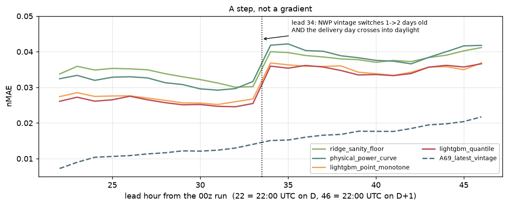

# Phase 4 sub-gate — What Open-Meteo Previous Runs actually gives us

**Run:** 2026-09-20. One day of work to protect the weeks that follow. The MOS design
assumes we can obtain archived forecasts *at a known lead time*; this report establishes
what the archive actually serves, and what bias that leaves.

## The semantics

`<var>_previous_dayN` is the value that was **available N × 24 hours before the valid
time**. It is defined by information age, not by run initialisation — the API does not
expose which cycle a value came from.

Measured at (59.0 N, 16.0 E), `ecmwf_ifs025`, 2025-06-01 → 2025-08-31, 2208 hours,
scored against ERA5 as a stand-in for truth:

| column | MAE vs ERA5 (m/s) | correlation |
|---|---|---|
| `wind_speed_100m` (freshest) | 0.499 | 0.959 |
| `wind_speed_100m_previous_day1` | 0.732 | 0.925 |
| `wind_speed_100m_previous_day2` | 0.988 | 0.865 |
| `wind_speed_100m_previous_day3` | 1.188 | 0.788 |

Monotone degradation with offset, which is the signature of increasing forecast lead.
The mapping is confirmed: these are genuine forecasts at increasing age, not re-served
analyses.

## The mismatch, stated plainly

The task issues at 09:00 UTC on day D for delivery on D+1. The **information age** of our
forecast therefore varies across the delivery day:

```
  delivery hour (local D+1)   00:00 ─────────────────────────────▶ 24:00
  age at 09:00 UTC issue       13 h ─────────────────────────────▶  36 h
  previous_day1 offset         ──────────── fixed 24 h ────────────
                               ↑ day1 is STALER          ↑ day1 is FRESHER
                                 (pessimistic here)        (optimistic here)
```

`previous_day1` is a fixed 24-hour age against our 13–36 hour range. It therefore
**understates** achievable skill for early delivery hours and **overstates** it for late
ones, crossing over around midday. Pooled across the delivery day the two effects partly
cancel, but they do not cancel per lead hour — which is exactly why metrics are reported
per lead hour rather than only pooled.

`previous_day2` (48 h) is uniformly staler than anything the task would use.

## This is leakage, not just optimism

The first draft of this report called `previous_day1` "mildly optimistic for late
delivery hours". That was too generous, and the leakage test said so on its first run:
**13 of every 24 delivery hours were carrying information that did not exist at issue
time.**

The arithmetic is exact. `previous_day1` has max source time `T − 24 h`. That is legal
only while `T − 24 h ≤ issue`, i.e. `T ≤ 09:00 UTC on D+1`. The delivery day runs to
21:00–22:00 UTC on D+1, so:

| delivery hours | information age needed | `previous_day1` legal? |
|---|---|---|
| first 11 | 14–24 h | yes (and it is *staler* than the task's own forecast) |
| last 13 | 25–37 h | **no — it postdates the issue time** |

`previous_day2` (48 h) is legal for the whole day but needlessly stale for the first 11
hours.

## Decision

**Pick the smallest safe offset per target hour**: `offset = ceil(age / 24 h)`, which is
1 for the first 11 hours of the delivery day and 2 for the remaining 13. Both offsets
are fetched for every variable, and the design matrix carries `nwp_offset_days` so the
choice is auditable per row.

The error-growth feature compares the *chosen* offset against one staler — never a
fresher one, which would reintroduce exactly the leak. That is why
`wind_speed_100m_previous_day3` is fetched as well.

The same defect existed in the lagged actuals: a 24-hour lag is the intuitive choice and
leaks on the same 13 hours. The minimum safe lag is 48 h, and `ACTUAL_LAGS_H` is now
(48, 72, 168).

Both are locked down by `research/tests/test_leakage.py`, which keeps the defective
fixed-offset construction as an explicit regression case — a guard that cannot fail is
worse than no guard.

The residual approximation, now bounded and honest: where offset 1 is chosen the feature
is 24 h old against a task age of 14–24 h, and where offset 2 is chosen it is 48 h old
against 25–37 h. Every feature is therefore **at least as stale** as the real forecast
would be, so the design is conservative rather than optimistic. Reported skill is a
floor, not a ceiling.

## What the conservative choice costs — measured, 2026-09-21

The design above is safe. It is not free, and Phase 5 measured the bill.



Error against lead hour is flat at ~0.026 through leads 22–33, flat at ~0.035 through
leads 34–46, and steps **+35% between them** — exactly where `nwp_offset_days` flips
from 1 to 2, with no overlap. Pooled lead blocks hid this; the per-lead breakdown this
report argued for is what exposed it.

Part of that step is genuine: lead 34 is 10:00 UTC on the delivery day, so the boundary
is also night→day, and daytime wind is harder to forecast. The two are perfectly
collinear under a fixed issue time. **A69 is the natural control** — a TSO product with
no Open-Meteo vintage switch — and it crosses lead 34 with no step at all. That points at
the vintage carrying most of the +35%.

**There is no cheaper fix inside this API.** `previous_dayN` is addressable only in whole
days; a `*_previous_run1` parameter was probed and is rejected outright:

```
Invalid value: Cannot initialize ... from invalid String value wind_speed_100m_previous_run1
```

A genuine 00z run covers +22…+47 h in a single initialisation, so none of the delivery
day needs a 48-hour-old forecast. Recovering that needs an archive addressable by **run
initialisation** rather than by information age. MET Norway's MEPS archive is exactly
that (`meps_archive.md`), which is why the ensemble spike is now also the fix for the
largest measured structural error in the model rather than a separate enhancement.

## Archive depth — shorter than planned

Bisected against the API, per model, at the SE3 centroid:

| model | archive starts | usable? |
|---|---|---|
| `ecmwf_ifs025` | **2024-03-06** | yes — primary |
| `gfs025` | 2024-02-16 | yes |
| `icon_eu` | 2024-02-16 | yes |
| `dmi_harmonie_arome_europe` | recent only (2026 ok, 2024 empty) | no — would make the feature set non-stationary |
| `knmi_harmonie_arome_europe` | recent only | no |
| `meteofrance_arpege_europe` | no data at this point | no |
| `ukmo_global_deterministic_10km` | no data at this point | no |
| `metno_nordic` | no data at this point | no |

So the matched-lead training set runs **2024-03-06 → present**, about **930 delivery
days**, of which the sealed holdout takes the last 184 — leaving roughly **745
development days**.

Two consequences:

- The multi-model spread feature rests on **three** models, not the four or five the plan
  assumed. Three still gives a usable spread; the two HARMONIE models join later, once
  their archives are long enough to be used without introducing a break.
- ~745 effective training samples confirms the discipline the plan committed to: modest
  feature counts, monotone constraints, day-blocked CV, and a bootstrap CI on every
  claimed improvement.

## Verdict

**GO.** The MOS premise survives, with a documented and bounded approximation in the
information age. The fallback — leaning harder on the ERA5-fitted physics layer — is not
needed, but the physics layer is built anyway as the baseline that tells us whether the
statistics earn their keep.
