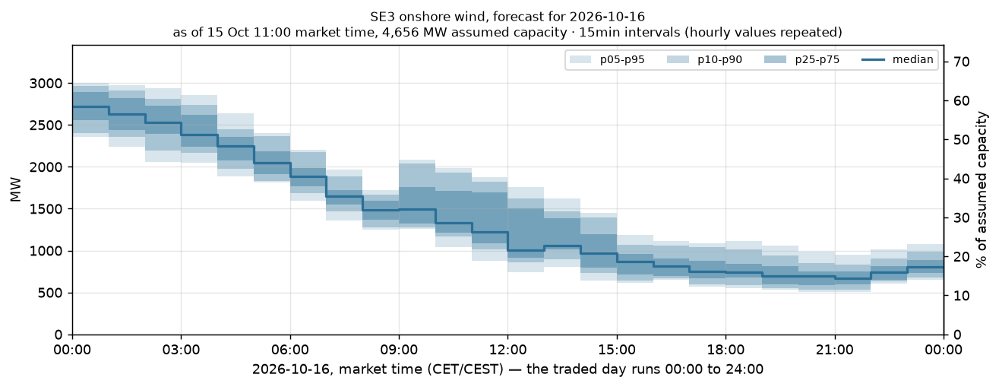
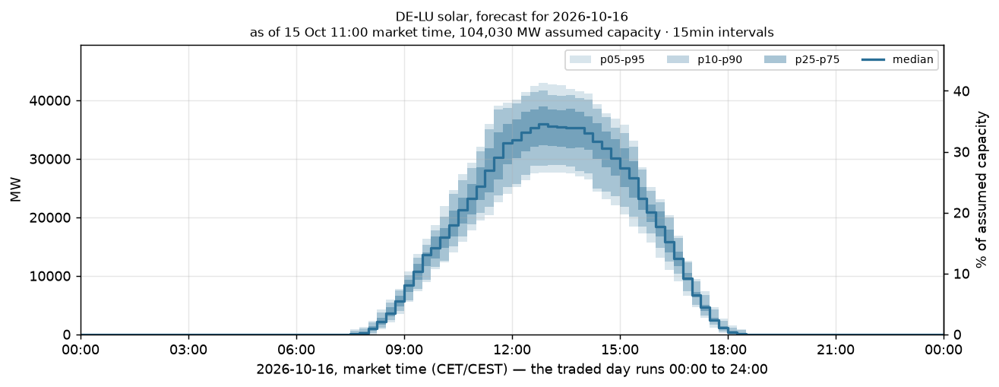

# Quarter-hour wind and solar products

Generated 2026-10-15 13:04 UTC. Development evaluation only; the sealed holdout has not been scored.

The added protocol fixes three monthly folds: December 2025, January 2026 and February 2026, with a seven-day embargo. Arms within each task use identical complete delivery days and genuine 15-minute observations. Counts can differ between tasks because their weather and observation coverage differ.

Both wind arms include the information-age correction for forward weather trajectory terms (+3 h). The September hourly board predates this correction and is historical evidence, not the accuracy of the corrected current code. Solar dates its irradiance interpolation to the following hourly endpoint.

## SE3 wind, hourly-trained Stage 1

Both arms use the same hourly-trained model. The reference repeats each hourly distribution four times; the candidate interpolates weather within each vintage before computing power-curve features. Repeated hourly distributions are the operational default: interpolation did not demonstrate a marginal CRPS gain in this A/B. Its mean CRPS is slightly higher, but the paired difference is not statistically resolved. It improves ramp MAE while worsening peak-ramp timing. Interpolation remains available with `predict --wind-method interpolate`. Neither method supplies native sub-hourly NWP skill.

| name | days | scored_intervals | nmae | crps | coverage_80 | coverage_90 |
|---|---|---|---|---|---|---|
| hourly_repeated | 79 | 7584 | 0.02902 | 0.02209 | 0.72244 | 0.86247 |
| interpolated_weather | 79 | 7584 | 0.02935 | 0.02230 | 0.73009 | 0.86340 |

| name | crps_delta_ci_low | crps_delta_ci_high | ramp_mae_cf | peak_ramp_timing_mae_min |
|---|---|---|---|---|
| hourly_repeated | 0.00000 | 0.00000 | 0.00438 | 249.30380 |
| interpolated_weather | -0.00015 | 0.00057 | 0.00391 | 341.58228 |

CRPS differences are against hourly repeated, with paired 95% day-block bootstrap intervals. Negative differences favour the named model. Ramp MAE is in capacity-factor changes per quarter-hour; timing error is in minutes for the largest absolute daily median ramp. Marginal quantiles do not describe joint ramp uncertainty.

## DE-LU solar, native quarter-hour training

Headline metrics exclude night: midpoint solar elevation must exceed 5° at at least one declared site. Capacity factors use the last annual A68 snapshot preceding issue, not a future year-end anchor. A dated MaStR denominator and fleet are still pending.

| name | days | scored_intervals | nmae | crps | coverage_80 | coverage_90 |
|---|---|---|---|---|---|---|
| solar_quantile | 90 | 2885 | 0.01955 | 0.01444 | 0.75459 | 0.88596 |
| smart_persistence | 90 | 2885 | 0.03230 | 0.02451 | 0.81075 | 0.91334 |
| solar_physical | 90 | 2885 | 0.03512 | 0.02566 | 0.68146 | 0.77262 |
| clear_sky_climatology | 90 | 2885 | 0.03988 | 0.02904 | 0.65754 | 0.84610 |

| name | crps_delta_ci_low | crps_delta_ci_high | ramp_mae_cf | peak_ramp_timing_mae_min |
|---|---|---|---|---|
| solar_quantile | -0.01753 | -0.01015 | 0.00126 | 161.33333 |
| smart_persistence | -0.00773 | -0.00017 | 0.00136 | 200.50000 |
| solar_physical | -0.00725 | 0.00270 | 0.00176 | 180.66667 |
| clear_sky_climatology | 0.00000 | 0.00000 | 0.00144 | 249.33333 |

CRPS differences are against clear-sky climatology, with paired 95% day-block bootstrap intervals. Negative differences favour the named model. Ramp MAE is in capacity-factor changes per quarter-hour; timing error is in minutes for the largest absolute daily median ramp. Marginal quantiles do not describe joint ramp uncertainty.

## Operational output

Forecasts contain 19 non-crossing quantiles in CF and MW, with zone, fuel, resolution, issue time, interval start/end, assumed capacity and model version. Local delivery days contain 92, 96 or 100 quarter-hours across DST. Archive appends are locked and atomic; readers filter by task. Production fitting uses observations from days ending before issue day and may use past holdout observations without scoring them.

### SE3 wind_onshore

Delivery 2026-10-16; 96 intervals; issue 2026-10-15 09:00 UTC; method `hourly_repeated`; capacity assumption 4,655.68 MW; version `55193a88-dirty+fc14e3d110d5`.



### DE_LU solar

Delivery 2026-10-16; 96 intervals; issue 2026-10-15 09:00 UTC; method `native`; capacity assumption 104,029.51 MW; version `55193a88-dirty+d4322b56ba48`.



## Archive refresh

Run-file coverage for 2026-03-01 → 2026-10-16 (exclusive), checked 2026-10-15T12:59:26.454880+00:00. Unavailable future cycles are excluded. Full missing-date lists are in `data/interim/weather_archive_status.json`.

| source | available_runs | missing_runs | latest_run |
|---|---|---|---|
| meps_00z | 228 | 1 | 2026-10-15 |
| ifs_runs_00z | 229 | 0 | 2026-10-15 |
| ifs_runs_18z | 228 | 0 | 2026-10-14 |

## Limits and remaining validation

The solar fleet is an equal-area six-site lattice with a fixed south/east/west orientation mix and nominal thermal/loss assumptions. It is a working first forecast, not a registry-weighted PV model. Its annual capacity snapshots lack publication vintages. Radiation comes from one pinned ECMWF model in the whole-day Previous Runs archive; solar IFS HRES single-run features are not yet implemented. Clear-sky-index interpolation approximates midpoint interval output and cannot resolve unobserved sub-hourly clouds. Missing weather remains missing rather than becoming zero sunshine.

Calibration is measured, not assumed to transfer from wind. Read nominal 80% and 90% coverage against their observed values above. Night-time solar quantiles are set to zero after calibration. Native quarter-hour wind training, joint-path energy/variogram scoring, the sealed holdout evaluation and a scheduled live trial remain separate work. These outputs are standalone research artifacts; the grid-signals integration contract still applies.

Method references: [Open-Meteo Previous Runs](https://open-meteo.com/en/docs/previous-runs-api) and [pvlib plane-of-array irradiance](https://pvlib-python.readthedocs.io/en/stable/reference/generated/pvlib.irradiance.get_total_irradiance.html). Solar requests explicitly use instantaneous radiation so the provider's backwards-hour-mean convention cannot shift the target labels. See the protocol amendment for all evaluation choices.

## Reproduce

```bash
export PYTHONPATH=research/src
uv run --group research python -m renewable_forecast.pipelines.refresh_archives 2026-03-01 2026-10-16
uv run --group research python -m renewable_forecast.pipelines.pull_solar 2024-03-06 2026-10-18
uv run --group research python -m renewable_forecast.pipelines.pull_actuals 2026-09-19 2026-10-16
uv run --group research python -m renewable_forecast.pipelines.backtest_products --fuel wind_onshore
uv run --group research python -m renewable_forecast.pipelines.backtest_products --fuel solar
uv run --group research python -m renewable_forecast.pipelines.predict --resolution 15min
uv run --group research python -m renewable_forecast.pipelines.predict --fuel solar --resolution 15min
uv run --group research python -m renewable_forecast.reporting.products
```
